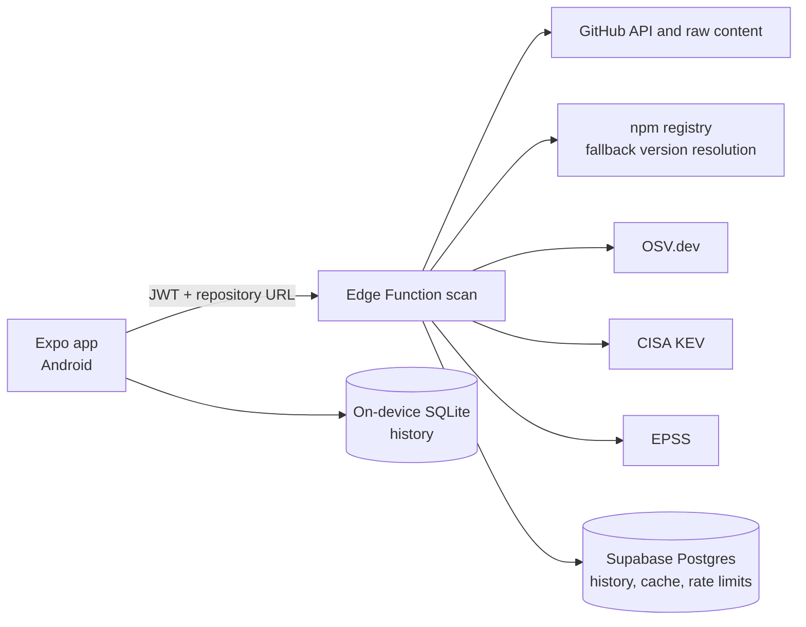

# PatchRadar

> Paste a public GitHub repository URL and get npm dependency vulnerabilities ranked by real-world exploitation evidence.


PatchRadar is an Android-first Expo application that scans a public GitHub repository for npm dependency vulnerabilities and turns the results into a short, prioritized action list. Paste a repository URL; PatchRadar reads the manifest, matches packages against OSV.dev, enriches findings with CISA KEV and EPSS, and labels each finding **Fix now** (*Tambal sekarang*), **Schedule** (*Jadwalkan*), or **Monitor** (*Pantau*).

The application interface and materials under `docs/` are in Indonesian. This README and all code identifiers are in English.

> **Project status (v1.0.0):** the MVP is functionally complete and an out-of-MVP add-on (`T-X-01`, saved repositories) is implemented and device-tested by the developer. The release gate (`T-W4-08`), final report, demo, and artifact handover are still open. See [`TASKS.md`](TASKS.md) for task-level status and evidence.

## Why PatchRadar

Students and junior developers often ship npm projects without checking dependency risk. Existing tools require a terminal (`npm audit`), repository setup (Dependabot), or produce equally weighted warnings with little context about real-world exploitation.

PatchRadar narrows the question to: **"From this public repository, which dependencies are vulnerable, and which ones should I handle first?"** It is not a replacement for `npm audit`, Dependabot, or a professional security audit, and it does not guarantee that a project is safe.

## Core features

- **One-step scan** — paste `https://github.com/owner/repo`; no GitHub login or repository setup is required.
- **Manifest coverage** — reads `package-lock.json` v2/v3 (direct, transitive, and dev entries) and falls back to `package.json`, clearly marked as estimated.
- **Evidence-based priority** — combines OSV advisories with CISA KEV exploitation data and EPSS probability.
  - **Fix now:** KEV-listed, or Critical severity with EPSS ≥ 0.10.
  - **Schedule:** High/Critical severity, or EPSS ≥ 0.05.
  - **Monitor:** everything else.
- **Actionable findings** — every finding includes severity, a one-sentence reason in Indonesian, references, and a copyable upgrade command for direct dependencies.
- **Offline history** — scans and details are stored in SQLite, so History → Result → Detail still works in airplane mode.
- **Graceful degradation** — partial results are shown with a banner when KEV or EPSS is unavailable; unexpected failures return a stable error code and a `requestId`.

### Saved repositories (out of MVP)

A floating PatchRadar button on the tab screens opens a local **Repo tersimpan** list:

- Save a GitHub repository URL with an optional note (up to 280 characters, 50 repositories).
- **Gunakan** fills the Scan field and switches to the Scan tab; **Salin**, **Ubah**, and **Hapus** manage each entry.
- Invalid URLs and case-insensitive duplicates are rejected with Indonesian messages.
- Data lives only in the on-device SQLite database (schema v2, `saved_repos` table). It is never sent to Supabase or any other server, and it is lost on uninstall.

This add-on is outside the MVP scope and is tracked as `T-X-01` in [`TASKS.md`](TASKS.md).

## How it works

1. The app validates the repository URL and creates an anonymous Supabase session.
2. The `scan` Edge Function fetches repository metadata and the default branch manifest from GitHub.
3. Packages are matched against OSV.dev; OSV advisories, KEV entries, and EPSS scores are cached in Supabase.
4. Findings are normalized, scored, labeled, and sorted by priority.
5. The app saves the result locally and renders the ranking; a best-effort copy is also persisted to Supabase under the anonymous user's ID.

## Architecture



| Component | Responsibility |
|---|---|
| `app/` | Expo Router UI, anonymous session, URL validation, SQLite history, theme handling. |
| `supabase/functions/scan/` | Validation, GitHub fetch, manifest parsing, OSV/KEV/EPSS enrichment, scoring, labels, rate limiting, retention, cloud persistence. |
| `supabase/migrations/` | Tables, indexes, RLS policies, and the lazy retention function. |

The app is intentionally thin: all tokens and heavy processing stay on the server so the APK contains no GitHub token or service-role key.

## Tech stack

| Layer | Technology |
|---|---|
| Mobile | Expo SDK 58, React Native 0.88, React 19.3, Expo Router, TypeScript (`strict`), SQLite, SecureStore |
| Backend | Supabase Edge Functions (Deno), Supabase Postgres with RLS |
| Build and test | EAS Build (Android APK), Jest + `jest-expo`, `node --test` |

## Getting started

### Prerequisites

- Node.js 24+ and npm (verified with Node 24.21.0 / npm 11.11.1)
- A Supabase project and the Supabase CLI (verified with CLI 3.0.0)
- An Expo account for EAS builds, or Expo Go for local development
- A GitHub fine-grained read-only token for the Edge Function

### 1. Set up the backend

From the repository root:

```powershell
npx supabase@latest link --project-ref <project-ref>
npx supabase@latest db push
npx supabase@latest secrets set GITHUB_TOKEN=<read-only-token> IP_HASH_SALT=<random-secret> RETENTION_DAYS=90
npx supabase@latest functions deploy scan --use-api --yes
```

Keep `GITHUB_TOKEN`, `IP_HASH_SALT`, and `SUPABASE_SERVICE_ROLE_KEY` server-side. Hosted Edge Functions receive `SUPABASE_URL` and `SUPABASE_SERVICE_ROLE_KEY` from Supabase; never copy them into `app/.env`.

### 2. Run the app

```powershell
cd app
npm install
Copy-Item .env.example .env
```

Fill `app/.env` with the two public values from **Supabase → Project Settings → API**:

```dotenv
EXPO_PUBLIC_SUPABASE_URL=https://<project-ref>.supabase.co
EXPO_PUBLIC_SUPABASE_ANON_KEY=<anon-public-key>
```

Then start Expo:

```powershell
npx expo start
```

Run `npx expo start --clear` after any `.env` change: `EXPO_PUBLIC_*` values are embedded at bundle time.

### 3. Sanity check

Open the app and scan `https://github.com/stylelint/stylelint`. A healthy setup returns a result screen with package counts and findings instead of an error. If the result is empty, check the Edge Function deployment, JWT verification, and the two public environment variables.

## Configuration

| Variable | Where | Purpose |
|---|---|---|
| `EXPO_PUBLIC_SUPABASE_URL` | `app/.env`, EAS environment | Public Supabase project URL. |
| `EXPO_PUBLIC_SUPABASE_ANON_KEY` | `app/.env`, EAS environment | Public anonymous key, protected by RLS. |
| `GITHUB_TOKEN` | Supabase Edge Function secret | Read-only GitHub access; raises API rate limits. |
| `SUPABASE_SERVICE_ROLE_KEY` | Supabase server environment | Server-side persistence; never shipped in the app. |
| `IP_HASH_SALT` | Supabase Edge Function secret | Enables the per-IP rate limit; raw IPs are never stored. |
| `RETENTION_DAYS` | Supabase Edge Function environment | Cloud retention window; default `90`, `off` disables cleanup. |

Anon keys are public by design. Service-role keys, GitHub tokens, salts, and keystores must never appear in the repository or the APK. See [`docs/environment.md`](docs/environment.md) for details.

## Testing and quality

Run app checks from `app/`:

```powershell
npm run lint
npm run typecheck
npm test -- --ci
```

Run backend checks from the repository root:

```powershell
node --test "supabase/functions/scan/**/*.test.ts"
```

**Last verified:** 26 November 2026 — 18 app suites / 172 tests passed, and ESLint plus TypeScript `strict` checks passed. The backend suite (216 tests) was last verified on 22 November 2026 at commit `cc4c4be` and was not re-run for the `T-X-01` change.

The backend suite covers URL validation, lockfile parsing, semver resolution, OSV/KEV/EPSS behavior, priority rules, rate limits, RLS-facing persistence, retention, and end-to-end handler responses.

## Build and release

The `release` profile in `app/eas.json` produces an Android APK, increments `versionCode` automatically, and uses the `production` EAS environment. Register both `EXPO_PUBLIC_*` variables in EAS before building.

```powershell
cd app
npx eas-cli@latest build --profile release --platform android
```

Build artifacts stay outside the repository. Each release build must record its SHA-256, `versionCode`, source commit, and device test evidence before the release gate is closed. Release status is tracked in [`TASKS.md`](TASKS.md) under `T-W4-08`.

## Security and privacy

- **Anonymous authentication** — the app creates a Supabase anonymous session; the JWT is stored in SecureStore.
- **Row Level Security** — users can read only their own scans and findings; the `anon` role is denied. Isolation was re-tested against the release build with `leakDetected=false`.
- **No secrets in the APK** — only the public anon key is bundled; GitHub and service-role credentials stay on the server.
- **Input and network hardening** — strict GitHub URL validation, host allowlists, bounded redirects, request timeouts, and manifest size limits.
- **Hashed IPs** — when `IP_HASH_SALT` is configured, only a salted hash is stored, never the raw address.
- **Minimal logging** — logs contain `requestId`, repository name, status, and timings, not tokens or full manifests.
- **Retention** — a 90-day cloud retention policy runs lazily after successful scans; purge verification with data older than 90 days is still pending.

Full review: [`docs/security-review.md`](docs/security-review.md) and [`docs/rls-test.md`](docs/rls-test.md).

## Limitations and non-goals

- Results are **potential** findings and do not prove exploitation; PatchRadar is not a substitute for a professional security audit.
- Only public GitHub repositories, the default branch, and the npm ecosystem are supported. Yarn/pnpm lockfiles are not primary inputs; without a lockfile, only direct dependencies are scanned and results are marked **estimated**.
- Limits per scan: 1,500 unique packages and a 5 MB manifest. Rate limits: 5 scans per 10 minutes per anonymous user, plus 20 scans per hour per hashed IP when enabled. Requests that end in 404 still count toward the quota.
- Local history is not restored after uninstall. Cloud copies are best-effort and are not re-synced to the device in this MVP; retention cleanup depends on a later successful scan, and a real purge of data older than 90 days has not been verified.
- Saved repositories (`T-X-01`, out of MVP) are stored only on the device. They are not synced, exported, or restored after uninstall, and they do not affect scans or the backend.
- Validation used a two-device self-test, so label comprehension and decision-support metrics are not yet measured. Measured p95 time to result was 5,621 ms for a 453-package repository (n=5, `T-W4-03`) and was not re-measured during final validation.
- Out of scope: GitHub login, private repositories, notifications, scheduled monitoring, pull requests, NVD, PDF export, scan comparison, and team dashboards.

See [`docs/limitations.md`](docs/limitations.md) for the complete list.

## Repository layout

| Path | Contents |
|---|---|
| `app/` | Expo Router application, components, hooks, SQLite access, tests. |
| `supabase/functions/scan/` | Scan Edge Function and its unit tests. |
| `supabase/migrations/` | Schema, indexes, RLS policies, retention function. |
| `fixtures/` | Real API responses and lockfile fixtures used by tests. |
| `scripts/` | CLI probes for external APIs, package counting, and RLS checks. |
| `docs/` | PRD, design, setup, security, validation, and release evidence. |

## Documentation

| Area | Documents |
|---|---|
| Product | [`docs/PRD.md`](docs/PRD.md), [`TASKS.md`](TASKS.md), [`docs/limitations.md`](docs/limitations.md) |
| Setup and design | [`docs/environment.md`](docs/environment.md), [`docs/supabase-setup.md`](docs/supabase-setup.md), [`docs/ui-design.md`](docs/ui-design.md) |
| Security | [`docs/security-review.md`](docs/security-review.md), [`docs/rls-test.md`](docs/rls-test.md) |
| Testing and release | [`docs/smoke-test.md`](docs/smoke-test.md), [`docs/validation-results.md`](docs/validation-results.md), [`docs/error-matrix.md`](docs/error-matrix.md), [`docs/due-diligence-log.md`](docs/due-diligence-log.md) |

## License

No license has been chosen for PatchRadar yet. The `app/LICENSE` file is the MIT license inherited from the Expo template and does not apply to this project.
