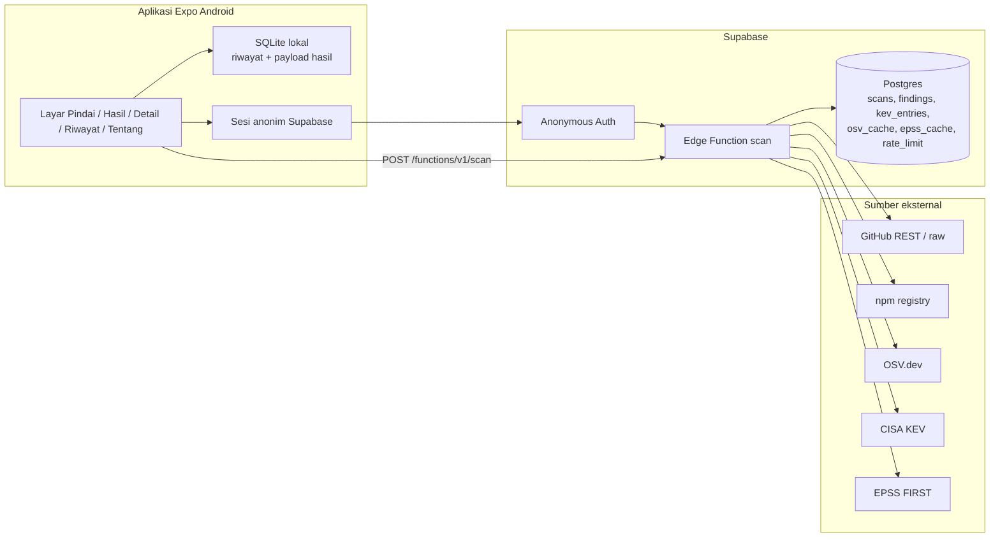
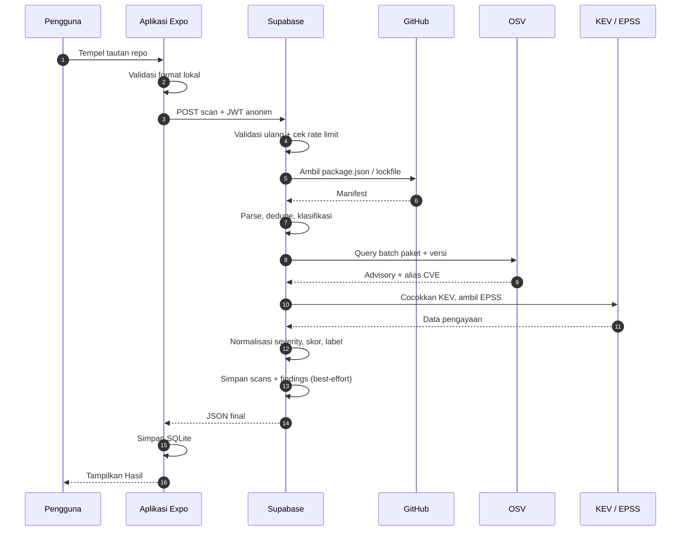
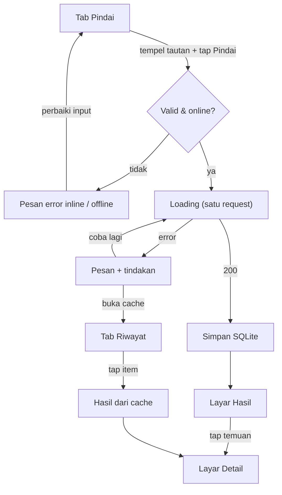

# PRD PatchRadar

| Atribut | Nilai |
|---|---|
| Nama produk | PatchRadar |
| Versi dokumen | 1.1 |
| Tanggal | 8 November 2026 |
| Status | Final untuk MVP |
| Pemilik | Pengembang tunggal (mahasiswa) |
| Platform | Android, Expo / React Native, TypeScript |
| Bahasa antarmuka | Indonesia |
| Target rilis | APK release candidate akhir Minggu 4 |

> Dokumen ini adalah acuan tunggal implementasi MVP. Keputusan pada bagian 4 bersifat final. Semua klaim tentang API eksternal yang belum diuji ditandai **[PERLU DIVERIFIKASI]** dan wajib dicek pada Minggu 1 sebelum dianggap fakta.

---

## 1. Ringkasan Eksekutif

PatchRadar adalah aplikasi Android yang memungkinkan pengguna menemukan kerentanan dependensi npm hanya dengan menempelkan tautan repo GitHub publik. Aplikasi mengambil `package.json` dan `package-lock.json`, mencocokkan paket dengan OSV.dev, memperkaya hasil dengan CISA KEV dan EPSS, lalu menampilkan setiap temuan dengan label **Tambal sekarang**, **Jadwalkan**, atau **Pantau**, alasan satu kalimat, penjelasan sederhana, dan langkah perbaikan.

Diferensiasi PatchRadar bukan kelengkapan data, melainkan alur kerja di ponsel: (1) cukup tempel tautan repo publik, (2) prioritas memakai bukti eksploitasi nyata (KEV dan EPSS), (3) hasil dijelaskan dalam bahasa sederhana disertai tindakan perbaikan. PatchRadar tidak menggantikan `npm audit`, Dependabot, atau alat komersial, dan tidak menjamin proyek aman atau benar-benar diserang.

MVP mencakup pemindaian repo publik npm, layar Pindai/Hasil/Detail/Riwayat/Tentang, cache offline SQLite, riwayat cloud dengan RLS, penanganan error, dan APK release candidate melalui EAS. Di luar MVP: login GitHub, repo privat, notifikasi, NVD, ekosistem selain npm, ekspor PDF, dan perbandingan pemindaian.

Kriteria lulus MVP: alur utama berjalan di perangkat Android nyata, target waktu hasil p95 ≤ 15 detik untuk lockfile ≤ 500 paket unik pada koneksi normal **[PERLU DIVERIFIKASI]**, RLS terbukti memisahkan dua pengguna anonim, riwayat dapat dibuka dalam mode pesawat, dan tidak ada crash pada seluruh skenario error di bagian 12.

---

## 2. Latar Belakang, Masalah, dan Tujuan

### 2.1 Latar belakang

Mahasiswa dan developer junior sering memakai banyak paket npm tanpa pernah memeriksa kerentanannya. Alat yang ada sebenarnya mampu menemukan kerentanan, tetapi:

- `npm audit` menuntut terminal/Node.js, sedangkan Dependabot menuntut setup di GitHub; keduanya kurang nyaman untuk pemeriksaan cepat dari ponsel.
- Peringatan yang muncul banyak dan setara; pengguna tidak tahu mana yang benar-benar sudah dieksploitasi di dunia nyata.
- Penjelasan teknis (CVE, CVSS, rentang versi) sulit diterjemahkan menjadi tindakan: "hari ini saya harus memperbaiki apa?".

PatchRadar mempersempit pertanyaan menjadi: **"Dari repo publik ini, dependensi mana yang punya kerentanan, dan mana yang harus saya tangani lebih dulu?"**

### 2.2 Masalah yang diselesaikan

1. Tidak ada jalur "tempel tautan → jawaban berprioritas" yang nyaman di ponsel.
2. Data eksploitasi nyata (KEV) dan peluang eksploitasi (EPSS) jarang disajikan bersama dengan bahasa sederhana.
3. Pengguna pemula tidak tahu apakah sebuah temuan berasal dari dependensi langsung, transitif, atau hanya dev.

### 2.3 Posisi terhadap alat lain

| Alat | Kekuatan | Keterbatasan untuk persona | Peran PatchRadar |
|---|---|---|---|
| `npm audit` | Cepat, dekat dengan proyek, mencakup dependensi terpasang | Butuh terminal/Node.js dan pemahaman output; kurang nyaman dari ponsel | Alternatif tanpa terminal untuk jawaban cepat; bukan pengganti audit menyeluruh |
| Dependabot | Terintegrasi GitHub, dapat membuat PR | Butuh setup repo/GitHub; fokus pada pembaruan, bukan penjelasan prioritas eksploitasi | Menambah konteks KEV/EPSS dan penjelasan bahasa sederhana |
| Layanan komersial | Data dan fitur lengkap | Berbayar, orientasi tim/enterprise, tidak ramah pemula | Fokus pada satu pertanyaan: apa yang perlu diperbaiki hari ini |

PatchRadar **tidak** mengklaim lebih lengkap dari alat di atas. Diferensiasinya adalah alur ponsel, prioritas berbasis eksploitasi nyata, dan penjelasan yang bisa ditindaklanjuti.

### 2.4 Tujuan (goals)

| ID | Tujuan | Ukuran keberhasilan |
|---|---|---|
| G-01 | Memindai repo GitHub publik dari ponsel dalam satu alur | ≥ 80% sesi validasi berhasil menghasilkan layar Hasil |
| G-02 | Memberi prioritas yang dapat dijelaskan | 100% temuan punya label + alasan satu kalimat |
| G-03 | Membantu keputusan perbaikan | ≥ 70% penguji menyatakan penjelasan membantu menentukan langkah |
| G-04 | Tetap berguna saat offline untuk riwayat | Hasil terakhir dapat dibuka dalam mode pesawat |
| G-05 | Menjaga data pengguna anonim | Dua pengguna anonim tidak dapat saling membaca riwayat (uji RLS) |

### 2.5 Non-goals (di luar MVP)

- Bukan pemindai kode sumber, rahasia (secret scanning), atau infrastruktur.
- Bukan jaminan bahwa proyek aman, tidak diserang, atau bebas dari false negative.
- Tidak memindai repo privat, organisasi yang membutuhkan SSO, atau branch selain default branch.
- Tidak mendukung yarn/pnpm lockfile sebagai sumber utama; hanya `package-lock.json` v2/v3 dan fallback `package.json`.
- Tidak mengirim notifikasi, tidak memantau repo secara berkala, tidak membuat pull request perbaikan.
- Tidak menampilkan NVD, skor CVSS sebagai satu-satunya dasar, atau data ekosistem selain npm.
- Tidak menyediakan ekspor PDF, perbandingan antar pemindaian, atau dasbor tim.

---

## 3. Persona

| Persona | Konteks | Tujuan | Rasa sakit | Cara PatchRadar membantu |
|---|---|---|---|---|
| **Mahasiswa Informatika** (utama) | Mengerjakan proyek web Node.js/React, memakai repo GitHub publik, belum pernah audit dependensi | Tahu apakah proyeknya berisiko dan apa yang harus diperbaiki sebelum dikumpulkan/di-deploy | Tidak paham istilah CVE/CVSS; tidak ingin memasang alat baru; sering hanya punya ponsel | Tempel tautan, baca label prioritas, salin satu perintah perbaikan untuk dependensi langsung |
| **Developer junior / freelancer** | Memegang 3–10 repo kecil, butuh jawaban cepat di sela pekerjaan | Menentukan repo/paket mana yang perlu ditangani hari ini | Peringatan banyak dan setara; konteks eksploitasi tidak terlihat | Daftar terurut, badge KEV/EPSS, alasan singkat, riwayat pemindaian |

Asumsi persona: pengguna sudah punya repo GitHub publik berisi proyek npm dan memahami cara menempelkan tautan. Pengguna tidak perlu memahami OSV, KEV, atau EPSS untuk memakai aplikasi.

---

## 4. Keputusan Produk Terkunci dan Perubahan terhadap Proposal

### 4.1 Keputusan terkunci

| Topik | Keputusan | Alasan |
|---|---|---|
| Sumber data | GitHub, npm registry, OSV.dev, CISA KEV, EPSS | Lima sumber cukup untuk manifest, pencocokan, dan prioritas; NVD dihapus dari MVP |
| Lockfile | `package-lock.json` v2/v3 dengan field `packages`: periksa semua paket prod+dev, langsung+transitif | Cakupan paling lengkap dan dapat dipertanggungjawabkan |
| Tanpa lockfile / v1 | Fallback `package.json`, hanya dependensi langsung, versi terbaru yang memenuhi range; semua ditandai **perkiraan** | Tetap memberi nilai tanpa mengklaim cakupan transitif |
| Arsitektur | Aplikasi Expo tipis; Supabase Edge Function `scan` melakukan seluruh kerja berat | Tidak ada token di APK; logika skor konsisten dan mudah diperbarui |
| Katalog KEV | Disimpan di tabel Supabase, refresh lazy bila salinan > 24 jam, tanpa cron | Menghindari infrastruktur terjadwal untuk MVP |
| Cache OSV | Tabel Supabase per (paket, versi) dengan TTL sementara 24 jam **[PERLU DIVERIFIKASI]** | Mengurangi panggilan berulang; nilai final masih perlu diverifikasi |
| Identitas | Supabase anonymous sign-in, tanpa login GitHub dan tanpa pemulihan akun | Friksi minimum; sesuai kebutuhan riwayat per pengguna anonim |
| Prioritas | Tambal sekarang: KEV **atau** Critical dengan EPSS ≥ 0,10. Jadwalkan: High/Critical **atau** EPSS ≥ 0,05. Pantau: sisanya | Aturan sederhana, dapat diuji, berbasis eksploitasi nyata |
| Severity | Sumber utama OSV, dinormalisasi ke Critical/High/Medium/Low/Unknown | Satu sumber agar konsisten; cara memperoleh severity yang konsisten dari OSV **[PERLU DIVERIFIKASI]** |
| Hasil | Hanya paket yang punya temuan; header "X paket diperiksa, Y punya temuan" | Mengurangi noise |
| Perbaikan | Perintah salin hanya untuk dependensi langsung dengan versi aman; transitif mendapat saran | Menghindari perintah yang salah konteks |
| Riwayat | SQLite lokal sebagai sumber utama tampilan; Supabase untuk riwayat cloud dengan RLS | Offline tetap bekerja; cloud memenuhi kebutuhan kepemilikan data |
| Scope | Hanya item pada bagian 5–6; fitur lain masuk Backlog Tahap 2 | Menjaga MVP selesai dalam 4 minggu |

### 4.2 Perubahan terhadap Proposal

Proposal awal sudah menempatkan NVD, login GitHub/repo privat, notifikasi push, PyPI/Maven, dan ekspor PDF di luar MVP. Proposal mencantumkan empat sumber di tabel due diligence (GitHub, OSV.dev, CISA KEV, EPSS) dan menyebut "tiga sumber data" untuk pengecekan dan pengayaan (OSV, KEV, EPSS). PRD v1.1 mempertahankan arah tersebut dan mencatat penyempurnaan berikut.

**(a) Perubahan nyata terhadap proposal**

| Topik | Proposal | PRD v1.1 | Alasan |
|---|---|---|---|
| Sumber data | Empat sumber di due diligence; "tiga sumber data" untuk pengecekan/pengayaan (OSV, KEV, EPSS) | npm registry menjadi sumber kelima, khusus untuk resolusi range saat lockfile tidak ada | Fallback `package.json` membutuhkan versi yang memenuhi range, bukan tebakan |
| Refresh KEV | KEV "diunduh berkala oleh backend" | Refresh lazy bila salinan > 24 jam, tanpa cron | Menghindari scheduler dan biaya operasional pada MVP |
| Perintah perbaikan | US-03 menampilkan `npm install {paket}@{versi}` bila versi perbaikan tersedia, tanpa membedakan langsung/transitif | Perintah salin hanya untuk dependensi langsung; transitif mendapat saran perbarui paket induk atau `npm audit fix` | Perintah install pada paket transitif berisiko salah konteks |
| Tampilan hasil | Tidak eksplisit membatasi daftar | Hanya paket yang punya temuan; tag langsung/transitif/dev; header memakai jumlah paket unik | Mengurangi noise dan menjelaskan asal temuan |
| Lockfile | Prioritaskan `package-lock.json` bila ada; penanda "perkiraan" bila hanya `package.json`; tidak menyebut versi lockfile | Hanya `package-lock.json` v2/v3; v1 jatuh ke mode perkiraan | Format `packages` v2/v3 yang mendukung pemindaian prod+dev dan transitif |
| Pembatasan laju | Tidak disebut | FR-25a (M) per pengguna anonim dan FR-25b (S) per hash IP | Mencegah penyalahgunaan anonymous sign-in dan pemborosan kuota |
| Batas ukuran manifest | Tidak disebut | NFR-09: 5 MB per file dan batas paket sementara 2.000 **[PERLU DIVERIFIKASI]** | Mencegah timeout/CPU berlebih pada repo besar |
| Hasil parsial dan persistensi | Tidak disebut | `partial`, `warnings[]`, dan `persisted`; penyimpanan cloud best-effort | Pengguna tetap mendapat hasil saat pengayaan atau penyimpanan cloud gagal |
| Target performa | Tidak disebut | p95 ≤ 15 detik untuk lockfile ≤ 500 paket unik **[PERLU DIVERIFIKASI]**; batas atas ditetapkan setelah uji Minggu 1 | Satuan "dependensi" ambigu karena lockfile memuat paket transitif |
| Anggaran CPU | Tidak disebut | NFR-17: CPU time `scan` di bawah batas platform **[PERLU DIVERIFIKASI]** | Waktu tunggu jaringan berbeda dari waktu CPU parsing/dedupe/semver |
| Batas data pengguna | Tidak disebut | Retensi cloud 90 hari (S) dan pembersihan lazy | Menjaga kuota dan privasi tanpa cron |

**(b) Tetap sama dengan proposal**

| Topik | Status |
|---|---|
| NVD, login GitHub/repo privat, notifikasi push, ekosistem PyPI/Maven, dan ekspor PDF; alur Pindai → Hasil → Detail; SQLite sebagai sumber utama tampilan; Supabase RLS dengan anonymous sign-in | Tetap di luar MVP atau tetap sama; tidak berubah di v1.1 |

Bila proposal telah dikumpulkan, perubahan di tabel (a) didokumentasikan di PRD ini sebagai penyempurnaan hasil studi kelayakan.

---

## 5. Kebutuhan Fungsional (FR)

Prioritas: **M** = wajib MVP, **S** = sebaiknya ada tetapi tidak memblokir rilis. Semua FR wajib lulus acceptance criteria (AC) saat demo.

| ID | Kebutuhan | US | Prioritas |
|---|---|---|---|
| FR-01 | Validasi tautan repo di klien | US-01 | M |
| FR-02 | Kirim satu permintaan pemindaian ke backend | US-01 | M |
| FR-03 | Ambil manifest dari GitHub | US-01 | M |
| FR-04 | Parse `package-lock.json` v2/v3 | US-01 | M |
| FR-05 | Fallback ke `package.json` dan tandai perkiraan | US-01 | M |
| FR-06 | Pencocokan OSV batch | US-01 | M |
| FR-07 | Cache OSV | US-01 | M |
| FR-08 | Refresh lazy katalog KEV | US-02 | M |
| FR-09 | Cocokkan temuan dengan KEV | US-02 | M |
| FR-10 | Pengayaan EPSS | US-02 | M |
| FR-11 | Normalisasi severity | US-02 | M |
| FR-12 | Klasifikasi langsung/transitif/dev | US-01, US-03 | M |
| FR-13 | Hitung label dan alasan | US-02 | M |
| FR-14 | Urutkan hasil | US-02 | M |
| FR-15 | Ringkasan hasil | US-01 | M |
| FR-16 | Penanda perkiraan | US-01 | M |
| FR-17 | Layar Hasil | US-01, US-02 | M |
| FR-18 | Layar Detail dan referensi | US-03 | M |
| FR-19 | Versi aman dan perintah salin | US-03 | M |
| FR-20 | Riwayat lokal | US-04 | M |
| FR-21 | Cache offline | US-04 | M |
| FR-22 | Simpan riwayat cloud dengan RLS | US-04 | M |
| FR-23 | Hasil parsial dan peringatan | US-01 | M |
| FR-24 | Penanganan error terstandar | US-05 | M |
| FR-25a | Pembatasan laju per pengguna anonim | US-05 | M |
| FR-25b | Pembatasan laju per hash IP | US-05 | S |
| FR-26 | Layar Tentang | US-02 | M |

### FR-01 — Validasi tautan repo di klien

- Menerima hanya `https://github.com/{pemilik}/{repo}` (opsional diakhiri `/` atau `.git`).
- Menolak host lain, `http://`, IP, subdomain, query, fragmen, dan path tambahan seperti `/tree/main`.
- Menampilkan pesan spesifik di bawah kolom input; tombol Pindai tidak mengirim request saat tidak valid.
- **AC:** `https://github.com/a/b` diterima; `https://gitlab.com/a/b`, `github.com/a/b`, `https://github.com/a/b/tree/main`, dan `https://github.com/a` ditolak dengan pesan berbeda yang menyebut format yang benar.

### FR-02 — Kirim satu permintaan pemindaian

- Satu tap Pindai mengirim tepat satu `POST` ke Edge Function `scan` dengan JWT sesi anonim.
- Tidak ada retry otomatis pada error 4xx; retry manual disediakan untuk error jaringan/5xx.
- **AC:** Memindai satu repo menghasilkan tepat satu respons 200 dan tidak menggandakan request; jika penyimpanan cloud berhasil, ada satu baris `scans`, dan jika gagal, `persisted=false` dengan hasil tetap diterima.

### FR-03 — Ambil manifest dari GitHub

- Backend memvalidasi ulang owner/repo, mengambil `package.json` dan `package-lock.json` dari root default branch.
- URL fetch dibentuk ulang dari owner/repo yang sudah divalidasi, bukan dari URL mentah pengguna.
- Jika `package.json` tidak ada, kembalikan `NO_PACKAGE_JSON`; jika lockfile tidak ada, lanjut ke FR-05.
- **AC:** Repo uji dengan kedua file menghasilkan `manifest.source=LOCKFILE`; repo tanpa lockfile menghasilkan `PACKAGE_JSON` dan `estimated=true`; repo tanpa `package.json` menghasilkan error yang sesuai.

### FR-04 — Parse lockfile v2/v3

- Menggunakan field `packages`; mengecualikan entri root `""`.
- Memasukkan seluruh paket prod dan dev, langsung dan transitif, lalu deduplikasi berdasarkan pasangan (nama, versi).
- Menandai `direct` bila nama ada di `dependencies`/`devDependencies` root; `devOnly` dari field `dev: true` pada entri lockfile.
- Entri tanpa versi (link/workspace) dilewati dan dicatat sebagai warning.
- **AC:** Repo uji 412 paket menghasilkan `totalPackages` sesuai jumlah unik (nama, versi) di lockfile; daftar pasangan (nama, versi) pada respons sama persis dengan hasil ekstraksi fixture; paket dev-only berlabel `dev`; paket langsung berlabel `langsung`; tidak ada paket root proyek yang dihitung sebagai dependensi.

### FR-05 — Fallback ke `package.json`

- Berlaku bila lockfile tidak ada, tidak dapat diparse, atau masih v1.
- Hanya `dependencies` dan `devDependencies` langsung.
- Versi = versi terbaru yang memenuhi range semver dari npm registry; jika registry gagal, gunakan batas bawah range.
- Range tanpa batas bawah bermakna (`*`, `latest`) dilewati dengan warning bila registry gagal.
- Semua hasil jalur ini memiliki `estimated=true` dan banner **"Hasil perkiraan"**.
- Spesifikasi non-registry (`git:`, `file:`, `workspace:`, URL) dilewati dengan warning.
- **AC:** Repo tanpa lockfile dengan `"lodash": "^4.17.0"` memakai versi 4.x terbaru yang tersedia saat uji dan `estimated=true`; saat registry disimulasikan gagal, dipakai `4.17.0` dan tetap `estimated=true`; lockfile v1 memicu jalur ini dengan banner perkiraan.

### FR-06 — Pencocokan OSV batch

- Mengirim query batch `{package: {name, ecosystem: "npm"}, version}` untuk setiap pasangan unik.
- Mengambil detail advisory yang diperlukan (ID, aliases, severity, summary, affected, references).
- **AC:** Paket uji yang diketahui rentan menghasilkan minimal satu finding dengan `osvId`; paket tanpa temuan tidak muncul di daftar; jumlah query batch sesuai jumlah paket unik (dalam chunk yang terdokumentasi).

### FR-07 — Cache OSV

- Menyimpan hasil per kunci `npm:{nama}@{versi}`, termasuk hasil kosong (negatif).
- Memakai cache bila `fetched_at` masih dalam TTL; TTL sementara 24 jam **[PERLU DIVERIFIKASI]**.
- Cache tidak boleh menyebabkan temuan baru terlewat setelah advisory diperbarui; setelah TTL, query ulang.
- **AC:** Pemindaian kedua repo yang sama menghasilkan `sourceStatus.osv="CACHE"` atau metrik cache hit, dan jumlah panggilan OSV turun tanpa mengubah daftar temuan.

### FR-08 — Refresh lazy katalog KEV

- Saat scan, jika `kev_entries.updated_at` lebih tua dari 24 jam, ambil katalog terbaru sebelum pencocokan.
- Jika refresh gagal tetapi salinan lama ada, pakai salinan lama dan tandai `STALE`.
- Jika belum ada salinan sama sekali dan refresh gagal, lanjutkan dengan `kev=false` + warning parsial.
- **AC:** Mengubah timestamp salinan menjadi > 24 jam memicu satu refresh; mematikan akses KEV tetap menghasilkan respons 200 dengan `sourceStatus.kev="STALE"` dan warning.

### FR-09 — Cocokkan temuan dengan KEV

- Cocokkan `cveIds` dari OSV (alias atau ID utama) dengan `cve_id` di katalog KEV.
- Satu kecocokan cukup untuk `kev=true`; temuan dengan KEV selalu berlabel **Tambal sekarang**.
- **AC:** Temuan uji dengan CVE yang ada di salinan KEV mendapat `kev=true` dan label `FIX_NOW`; temuan tanpa CVE tidak pernah diberi `kev=true`.

### FR-10 — Pengayaan EPSS

- Ambil EPSS untuk semua CVE unik; jika satu temuan punya beberapa CVE, pakai nilai EPSS tertinggi.
- Jika tidak ada CVE atau EPSS tidak tersedia, `epss=null` dan `epssAvailable=false`.
- **AC:** Temuan dengan CVE yang tersedia di EPSS menampilkan nilai 0–1 dan persentil; temuan tanpa CVE menampilkan "EPSS tidak tersedia" tanpa mengubah label secara diam-diam.

### FR-11 — Normalisasi severity

- Urutan sumber: severity terstruktur OSV → skor CVSS v3 → `database_specific.severity` → `UNKNOWN`.
- Pemetaan CVSS: 9,0–10,0 Critical; 7,0–8,9 High; 4,0–6,9 Medium; 0,1–3,9 Low; tidak ada = Unknown.
- **AC:** Empat advisory uji dengan CVSS 9,8 / 7,5 / 5,0 / 2,0 menghasilkan Critical/High/Medium/Low; advisory tanpa severity menghasilkan Unknown dan tetap dapat dilabeli lewat EPSS/KEV.

### FR-12 — Klasifikasi langsung/transitif/dev

- `direct=true` hanya untuk paket yang tercantum di manifest root.
- `devOnly=true` hanya bila paket tidak dibutuhkan oleh dependensi produksi (menggunakan field `dev` lockfile **[PERLU DIVERIFIKASI]**; untuk fallback, berdasarkan blok `devDependencies`).
- UI menampilkan tag **langsung** atau **transitif**, plus **dev** bila `devOnly`.
- **AC:** Satu paket langsung produksi, satu langsung dev, dan satu transitif dev pada repo uji menghasilkan kombinasi tag yang benar.

### FR-13 — Hitung label dan alasan

- Terapkan aturan bagian 11 secara deterministik; label hanya `FIX_NOW`, `SCHEDULE`, atau `MONITOR`.
- Setiap temuan punya `reason` satu kalimat dalam bahasa Indonesia yang menyebut pemicu utama.
- **AC:** Empat kasus uji (KEV, Critical+EPSS 0,10, High, Medium+EPSS 0,05) menghasilkan label dan alasan yang sesuai; tidak ada temuan tanpa alasan.

### FR-14 — Urutkan hasil

- Urutan: peringkat label (Tambal sekarang → Jadwalkan → Pantau), lalu `kev=true` lebih dulu, lalu skor turun, lalu EPSS turun, lalu nama paket A–Z.
- **AC:** Daftar contoh dengan campuran label dan KEV tampil persis dalam urutan yang ditentukan; temuan KEV selalu berada di atas temuan non-KEV pada label yang sama.

### FR-15 — Ringkasan hasil

- Header menampilkan `"{totalPackages} paket diperiksa, {affectedPackages} punya temuan"`.
- `totalPackages` menghitung paket unik (nama, versi) yang diperiksa, termasuk transitif; `affectedPackages` menghitung paket unik yang punya minimal satu temuan, bukan jumlah advisory.
- Jika tidak ada temuan, tampilkan empty state positif yang tidak mengklaim proyek aman.
- **AC:** Repo uji 412 paket unik dengan 13 paket terimbas menampilkan teks persis tersebut; repo tanpa temuan menampilkan "Tidak ada temuan pada data yang diperiksa" dan pengingat bahwa hasil bersifat potensial.

### FR-16 — Penanda perkiraan

- Jalur fallback menampilkan badge **Perkiraan** di Hasil dan Detail, plus penjelasan singkat bahwa hanya dependensi langsung yang diperiksa.
- `estimated=true` juga disimpan di SQLite dan cloud.
- **AC:** Repo tanpa lockfile menampilkan badge di kedua layar dan setelah dibuka ulang dari Riwayat.

### FR-17 — Layar Hasil

- Menampilkan repo, waktu scan, ringkasan, banner parsial/perkiraan, dan daftar temuan terurut.
- Setiap kartu: nama paket, versi terpasang, label, severity, KEV/EPSS, tag langsung/transitif/dev, alasan.
- Jika `totalPackages` berada di atas target 500 tetapi di bawah batas atas, tampilkan banner penjelasan "Repo besar; pemindaian bisa lebih lama dari biasanya". Selama loading lebih dari 5 detik, tampilkan indikator progres dan penjelasan serupa agar pengguna tidak mengira aplikasi macet.
- Tap kartu membuka Detail.
- **AC:** Dari Pindai, layar Hasil tampil ≤ 15 detik (p95, lockfile ≤ 500 paket unik, koneksi normal) **[PERLU DIVERIFIKASI]** dan semua elemen wajib ada pada setiap kartu; lockfile 501–2.000 paket menampilkan indikator progres/banner, tetap diproses, dan tidak melewati batas keras 25 detik.

### FR-18 — Layar Detail dan referensi

- Menampilkan nama paket, versi terpasang, versi aman (jika ada), severity, EPSS, status KEV, label + alasan, ringkasan dampak, dan tautan referensi.
- Tautan referensi membuka browser; jika gagal, tampilkan pesan dan tetap sediakan URL yang bisa disalin.
- **AC:** Detail dapat dibuka dari Hasil dan dari Riwayat offline; semua field yang tersedia tampil; tautan membuka advisory yang benar.

### FR-19 — Versi aman dan perintah salin

- `safeVersion` = versi perbaikan terendah yang lebih tinggi dari versi terpasang dan tercantum pada event `fixed` advisory; jika tidak ada, `null`.
- Perintah `npm install {paket}@{versi-aman}` hanya untuk `direct=true` dan `safeVersion != null`.
- Transitif: tampilkan saran "Perbarui paket induk atau jalankan `npm audit fix`", tanpa tombol salin perintah install.
- Tombol salin memberi umpan balik "Perintah disalin".
- **AC:** Temuan langsung dengan perbaikan menampilkan tombol salin dan perintah yang benar; temuan transitif tidak menampilkan perintah install; temuan tanpa perbaikan menampilkan "Belum ada versi aman yang diketahui".

### FR-20 — Riwayat lokal

- Setiap scan sukses/parsial disimpan ke SQLite sebelum layar Hasil ditampilkan.
- Riwayat diurutkan dari waktu terbaru, menampilkan repo, waktu, jumlah temuan, dan badge label dominan.
- Tap item membuka Hasil dari data lokal.
- **AC:** Setelah dua scan, Riwayat menampilkan dua item terurut; item tetap ada setelah aplikasi ditutup paksa dan dibuka kembali.

### FR-21 — Cache offline

- Mode pesawat: Riwayat dan Hasil/Detail yang pernah dibuka tetap dapat diakses dari SQLite.
- Layar menampilkan waktu pemindaian dan tag **"data dari cache"**.
- Memulai scan baru saat offline menampilkan pesan khusus, bukan crash atau spinner tanpa akhir.
- **AC:** Matikan jaringan, buka Riwayat → Hasil → Detail; semua tampil; tag cache terlihat; tap Pindai menampilkan pesan offline dalam ≤ 2 detik.

### FR-22 — Simpan riwayat cloud dengan RLS

- Backend menyimpan `scans` dan `findings` dengan `user_id` dari JWT anonim.
- Klien hanya dapat `SELECT` data miliknya; tidak ada akses tulis langsung dari klien.
- Jika penyimpanan cloud gagal, respons tetap 200 dengan `persisted=false` dan warning `CLOUD_PERSIST_FAILED`; hasil tetap ditampilkan dan disimpan di SQLite. Tidak ada retry dari klien dan tidak ada sinkronisasi ulang di MVP.
- **AC:** Dua pengguna anonim A dan B: B tidak dapat membaca scan A lewat REST/SDK (0 baris atau error); A dapat membaca miliknya; pengujian dilakukan pada build rilis, bukan hanya dashboard. Simulasi kegagalan tulis cloud menghasilkan 200, `persisted=false`, satu warning, dan riwayat lokal tetap bertambah.

### FR-23 — Hasil parsial dan peringatan

- Respons 200 dapat memiliki `partial=true` dan `warnings[]` bila pengayaan KEV/EPSS gagal atau lockfile sebagian dilewati. Kegagalan penyimpanan cloud menambahkan warning `CLOUD_PERSIST_FAILED` dan `persisted=false` tanpa harus mengubah `partial`.
- Label tetap dihitung dari data yang ada; UI menampilkan banner "Sebagian data pengayaan tidak tersedia; label dapat berubah setelah data lengkap."
- Jika OSV gagal total atau manifest gagal diambil, tidak ada hasil parsial; kembalikan error.
- **AC:** Simulasi EPSS gagal menghasilkan 200, `partial=true`, satu warning, dan banner di Hasil; simulasi OSV gagal menghasilkan error 502 tanpa baris scan sukses; simulasi gagal simpan cloud menghasilkan warning `CLOUD_PERSIST_FAILED` tanpa mengubah label.

### FR-24 — Penanganan error terstandar

- Semua error backend memakai bentuk `{error:{code,message,retryable,requestId}}`.
- Klien memetakan kode ke pesan bahasa Indonesia pada matriks bagian 12 dan tidak pernah menampilkan stack trace.
- **AC:** Setiap kondisi pada matriks error diuji manual; aplikasi tetap berada di layar yang wajar dan menyediakan tindakan lanjutan (coba lagi, buka cache, atau kembali).

### FR-25a — Pembatasan laju per pengguna anonim (M)

- Maksimum 5 scan per 10 menit per pengguna anonim (nilai awal, dapat dikalibrasi).
- Aplikasi memakai ulang sesi anonim yang ada; tidak membuat pengguna baru setiap scan. Pembuatan sesi mengikuti kontrol/batas Supabase **[PERLU DIVERIFIKASI]**.
- Melebihi batas menghasilkan 429 dengan `retryAfter` detik.
- Pembatasan berlaku di backend, bukan hanya UI.
- **AC:** Scan ke-6 dalam 10 menit menghasilkan 429 dan pesan dengan waktu tunggu; setelah jendela berlalu, scan diterima; membuka ulang aplikasi dan memindai tidak menambah baris `auth.users` baru.

### FR-25b — Pembatasan laju per hash IP (S)

- Bila diaktifkan, maksimum 20 scan per jam per hash IP, berlaku sebagai lapisan tambahan di atas FR-25a.
- Hash IP tidak menyimpan alamat IP mentah dan tidak dipakai untuk identitas pengguna.
- Jika fitur ini dipotong, FR-25a tetap melindungi per pengguna anonim; risiko penyalahgunaan lintas akun dicatat di R-09.
- **AC:** Dengan fitur aktif, beberapa akun anonim dari IP uji yang sama melewati batas menghasilkan 429; menonaktifkan fitur tidak mengubah AC FR-25a.

### FR-26 — Layar Tentang

- Menjelaskan arti tiga label, sumber data, arti "potensial", dan batas anonymity.
- Menegaskan PatchRadar tidak menjamin proyek aman atau tidak diserang.
- **AC:** Layar dapat dibuka dari tab Tentang tanpa jaringan; ketiga definisi label dan pernyataan "potensial" terlihat.

---

## 6. Kebutuhan Non-Fungsional (NFR)

Prioritas mengikuti tabel FR: **M** = wajib MVP, **S** = dapat dipotong lebih dulu saat telat. NFR tanpa tanda prioritas berarti **M**.

| ID | Kebutuhan | Acceptance criteria |
|---|---|---|
| NFR-01 | Performa | p95 waktu hasil ≤ 15 detik untuk lockfile ≤ 500 paket unik (nama, versi) pada koneksi normal, diukur dari tap Pindai sampai layar Hasil terisi **[PERLU DIVERIFIKASI]**. Lockfile di atas 500 tetapi di bawah batas atas NFR-09 tetap diproses; boleh melewati 15 detik, tidak boleh melewati batas keras, dan UI menampilkan indikator progres/penjelasan. |
| NFR-02 | Batas waktu | Anggaran lunak backend 12 detik, batas keras 25 detik; melewati batas keras menghasilkan `SCAN_TIMEOUT` 504. Pengayaan yang lambat boleh menghasilkan parsial; repo besar tidak boleh dipotong diam-diam. |
| NFR-03 | Tanpa secret di APK | Tidak ada token GitHub, service role Supabase, atau kunci pihak ketiga di bundle; anon key Supabase bersifat publik dan dilindungi RLS. Diperiksa dengan pencarian string pada APK dan inspeksi environment EAS. |
| NFR-04 | Validasi input berlapis | Validasi regex yang sama di klien dan server; server membentuk URL fetch dari owner/repo tervalidasi; tidak ada SSRF ke host lain. |
| NFR-05 | Isolasi RLS | Uji dua pengguna anonim pada build rilis membuktikan pengguna B tidak dapat membaca scan A; tidak ada policy `USING (true)` pada tabel pengguna. |
| NFR-06 | Privasi | Hanya tautan repo, manifest, dan metadata paket yang diproses; kode sumber tidak diunduh; log tidak memuat JWT, token, atau isi manifest penuh. |
| NFR-07 | Offline | Riwayat dan detail tersimpan dapat dibuka tanpa jaringan; tidak ada crash saat koneksi hilang di tengah request. |
| NFR-08 | Ketahanan | Retry maksimum 2 kali dengan backoff untuk 429/5xx sumber eksternal; tidak ada retry untuk 4xx input; kegagalan satu sumber pengayaan tidak menjatuhkan seluruh scan. |
| NFR-09 | Kapasitas | Batas 2.000 pasangan paket unik dan 5 MB per file manifest adalah nilai **SEMENTARA** yang wajib ditetapkan ulang setelah uji Minggu 1 **[PERLU DIVERIFIKASI]**. Lockfile 501–2.000 paket tetap diproses (boleh > 15 detik, wajib < batas keras); di atas batas menghasilkan `MANIFEST_TOO_LARGE`, bukan timeout misterius. |
| NFR-10 | Build | APK release candidate dihasilkan lewat EAS dan dapat dipasang di minimal satu perangkat Android fisik. **[PERLU DIVERIFIKASI]** konfigurasi EAS dan level Android minimum. |
| NFR-11 **(M/S)** | Bahasa dan aksesibilitas | **M:** seluruh teks UI berbahasa Indonesia, tombol memiliki label aksesibel, ukuran teks mengikuti pengaturan sistem. **S:** kontras/tema gelap lanjutan dan penyesuaian visual tambahan. AC M: teks Indonesia dan label aksesibel terverifikasi; AC S: tema gelap/kontras lanjutan lulus pemeriksaan visual. |
| NFR-12 **(M/S)** | Observabilitas | **M:** setiap respons/error memiliki `requestId`; log backend mencatat durasi per sumber dan kode error tanpa data sensitif; tidak ada SDK analitik pihak ketiga di MVP. **S:** agregasi metrik operasional (cache hit, tingkat parsial) dan retensi log terstruktur. AC M: `requestId` dan log durasi ada pada setiap scan; AC S: metrik agregat tersedia tanpa data pribadi. |
| NFR-13 | Kompatibilitas | Berjalan pada Android 8.0+ (asumsi) dan Expo SDK yang dipilih saat implementasi. **[PERLU DIVERIFIKASI]** dukungan Expo SDK terhadap versi Android minimum. |
| NFR-14 **(S)** | Retensi | Riwayat cloud disimpan 90 hari (asumsi) dan dibersihkan secara lazy saat scan berikutnya, bukan cron. Jika dipotong, data disimpan sampai pembersihan manual dan risiko kuota mengikuti R-08. Pengguna dapat menghapus data lokal dengan menghapus aplikasi. |
| NFR-15 | Biaya | MVP berjalan dalam kuota gratis Supabase dan GitHub yang tersedia; jika kuota terlampaui, degradasi (cache/429) lebih dipilih daripada menambah layanan berbayar. **[PERLU DIVERIFIKASI]** batas kuota. |
| NFR-16 | Keterujian | Parser lockfile, resolver semver, pemetaan severity, dan mesin label memiliki unit test; jalur utama dan error diuji manual pada perangkat. |
| NFR-17 | Anggaran CPU | Fungsi `scan` harus selesai di bawah batas CPU time platform untuk lockfile pada target; log mencatat CPU time dan wall time per sumber. Batas CPU time per request mengikuti dokumentasi Supabase saat ini dan belum dianggap angka pasti **[PERLU DIVERIFIKASI: batas CPU time per request pada dokumentasi Supabase saat ini]**. AC: uji fixture ≥ 400 dan ≥ 1.500 paket mencatat CPU time aktual dan persentasenya terhadap batas platform. |

---

## 7. Arsitektur Tingkat Tinggi

### 7.1 Diagram arsitektur



### 7.2 Alur utama



### 7.3 Pembagian tanggung jawab

| Komponen | Tanggung jawab | Tidak boleh dilakukan |
|---|---|---|
| Aplikasi Expo | Validasi awal URL, memanggil `scan`, menampilkan hasil, menyimpan/membaca SQLite, mengelola sesi anonim, menampilkan pesan error | Menyimpan token GitHub/service role, menghitung label, memanggil OSV/KEV/EPSS langsung |
| Edge Function `scan` | Validasi server, fetch manifest, parse lockfile, resolve versi, panggil OSV/KEV/EPSS, hitung skor/label, simpan hasil best-effort, rate limit | Mempercayai URL mentah klien, mengekspos service role ke klien |
| Supabase Auth | Membuat/menyimpan identitas anonim | Login sosial/GitHub pada MVP |
| Postgres + RLS | Menyimpan riwayat, cache, katalog KEV; menegakkan isolasi baca | Menjadi sumber utama tampilan riwayat di perangkat |
| SQLite lokal | Sumber utama Riwayat dan tampilan offline | Menyimpan rahasia atau token |
| Sumber eksternal | Menyediakan manifest, advisory, katalog, skor | — |

Batas kepercayaan: klien tidak dipercaya. Server selalu memvalidasi ulang `repoUrl` dan membentuk URL fetch sendiri. Edge Function menggunakan service role hanya di sisi server untuk menulis `scans`/`findings`; klien memakai JWT anonim dan hanya mendapat akses baca sesuai RLS.

---

## 8. Model Data Tingkat Konseptual

Tanpa SQL final. Tipe dan nama dapat menyesuaikan implementasi selama kontrak API tidak berubah.

### 8.1 Tabel Supabase

| Tabel | Kolom konseptual | Catatan |
|---|---|---|
| `scans` | `id` (uuid, PK), `user_id` (uuid, FK auth.users), `repo_owner`, `repo_name`, `repo_url`, `status` (COMPLETED/PARTIAL), `manifest_source` (LOCKFILE/PACKAGE_JSON), `lockfile_format` (v2/v3/none), `estimated` (bool), `total_packages` (int), `affected_packages` (int), `finding_count` (int), `partial` (bool), `warnings` (jsonb), `source_status` (jsonb), `engine_version`, `duration_ms`, `created_at` | Satu baris per pemindaian sukses/parsial. `user_id` dari JWT. |
| `findings` | `id` (uuid, PK), `scan_id` (FK), `osv_id`, `cve_ids` (text[]), `package_name`, `installed_version`, `direct` (bool), `dev_only` (bool), `parent_package`, `severity`, `cvss_score`, `epss` (numeric null), `epss_percentile`, `kev` (bool), `label`, `score`, `reason`, `fix_version`, `fix_command`, `summary`, `references` (jsonb), `created_at` | Satu baris per pasangan paket+advisory. `findingId` dipakai rute Detail. |
| `kev_entries` | `cve_id` (PK), `vendor`, `product`, `name`, `date_added`, `known_ransomware`, `raw` (jsonb), `updated_at` | Salinan katalog; satu baris per CVE. |
| `osv_cache` | `cache_key` (PK, mis. `npm:lodash@4.17.15`), `payload` (jsonb), `fetched_at` | Termasuk hasil negatif. |
| `epss_cache` | `cve_id` (PK), `epss` (numeric), `percentile` (numeric), `fetched_at` | **S (opsional):** cache EPSS untuk mengurangi panggilan; jika dipotong, EPSS diambil ulang per scan. |
| `rate_limit_events` | `id`, `user_id`, `ip_hash` (nullable, hanya FR-25b), `kind`, `created_at` | Indeks pada `user_id`+`created_at`; indeks `ip_hash` hanya bila FR-25b aktif. |
| `auth.users` | Dikelola Supabase | Tidak ada profil tambahan pada MVP. |

**RLS konseptual:** `scans` hanya `SELECT` bila `user_id = auth.uid()`; `findings` hanya `SELECT` bila `scan_id` dimiliki pengguna; klien tidak mendapat izin tulis; `kev_entries`, `osv_cache`, `epss_cache`, `rate_limit_events` tidak dapat diakses klien. Service role hanya dipakai Edge Function.

### 8.2 Skema SQLite lokal

| Tabel | Kolom konseptual | Catatan |
|---|---|---|
| `local_scans` | `scan_id` (PK), `repo_full_name`, `repo_url`, `scanned_at`, `status`, `manifest_source`, `estimated`, `partial`, `persisted` (bool, informasi), `total_packages`, `affected_packages`, `finding_count`, `payload_json` | `payload_json` menyimpan respons final agar Hasil dapat dirender ulang; `persisted` hanya mencatat apakah cloud berhasil menyimpan. |
| `local_findings` | `finding_id` (PK), `scan_id` (FK), `package_name`, `installed_version`, `severity`, `label`, `osv_id`, `payload_json` | Indeks pada `scan_id`; mempercepat Detail tanpa mem-parse seluruh payload. |
| `local_meta` | `key` (PK), `value` | Mis. versi skema lokal dan timestamp pemeliharaan. |

SQLite adalah sumber utama tampilan Riwayat. Cloud bersifat best-effort: jika penyimpanan cloud gagal, backend mengembalikan `persisted=false` + warning `CLOUD_PERSIST_FAILED`; hasil tetap ditampilkan dan disimpan lokal. Klien tidak melakukan retry atau sinkronisasi ulang di MVP.

---

## 9. Kontrak Endpoint `scan`

### 9.1 Request

`POST {SUPABASE_URL}/functions/v1/scan`

Header wajib:

| Header | Nilai |
|---|---|
| `Authorization` | `Bearer {access_token}` dari sesi anonim |
| `apikey` | anon key Supabase |
| `Content-Type` | `application/json` |
| `X-Client-Version` | versi aplikasi, mis. `1.0.0` |

```json
{
  "repoUrl": "https://github.com/demo-user/patchradar-demo",
  "clientVersion": "1.0.0"
}
```

### 9.2 Respons sukses (200)

```json
{
  "scanId": "6f1c2a9e-3b7d-4c21-9e8a-0d5f7a1b2c34",
  "repo": {
    "owner": "demo-user",
    "name": "patchradar-demo",
    "url": "https://github.com/demo-user/patchradar-demo",
    "defaultBranch": "main"
  },
  "scannedAt": "2026-11-08T10:15:30.000Z",
  "status": "COMPLETED",
  "manifest": {
    "source": "LOCKFILE",
    "lockfileFormat": "v3",
    "estimated": false
  },
  "summary": {
    "totalPackages": 412,
    "affectedPackages": 13,
    "findingCount": 17
  },
  "findings": [
    {
      "findingId": "b1e2d3c4-1111-4222-8333-944455556666",
      "osvId": "GHSA-aaaa-bbbb-cccc",
      "cveIds": ["CVE-2099-0001"],
      "package": {
        "name": "minimist",
        "installedVersion": "1.2.5",
        "direct": false,
        "devOnly": false,
        "parentPackage": "mkdirp"
      },
      "severity": { "level": "CRITICAL", "cvss": 9.8, "source": "OSV" },
      "exploitation": {
        "kev": true,
        "epss": 0.842,
        "epssPercentile": 0.99,
        "epssAvailable": true
      },
      "priority": {
        "label": "FIX_NOW",
        "score": 89.5,
        "reason": "Kerentanan ini sudah dieksploitasi nyata dan tercatat di CISA KEV, jadi ini prioritas tertinggi."
      },
      "fix": {
        "safeVersion": "1.2.8",
        "command": null,
        "suggestion": "Perbarui paket induk yang menarik dependensi ini, atau jalankan npm audit fix di proyek Anda."
      },
      "summary": "Penyerang dapat mengirim input yang mengubah perilaku program saat dependensi ini dipakai.",
      "references": [
        { "label": "Advisory OSV", "url": "https://osv.dev/vulnerability/GHSA-aaaa-bbbb-cccc" }
      ]
    },
    {
      "findingId": "c2f3e4d5-2222-4333-8444-a55566667777",
      "osvId": "GHSA-dddd-eeee-ffff",
      "cveIds": ["CVE-2099-0002"],
      "package": {
        "name": "lodash",
        "installedVersion": "4.17.15",
        "direct": true,
        "devOnly": false,
        "parentPackage": null
      },
      "severity": { "level": "HIGH", "cvss": 7.4, "source": "OSV" },
      "exploitation": {
        "kev": false,
        "epss": 0.021,
        "epssPercentile": 0.62,
        "epssAvailable": true
      },
      "priority": {
        "label": "SCHEDULE",
        "score": 45.7,
        "reason": "Severity High, tetapi belum ada bukti eksploitasi nyata yang kuat."
      },
      "fix": {
        "safeVersion": "4.17.21",
        "command": "npm install lodash@4.17.21",
        "suggestion": null
      },
      "summary": "Versi lama paket ini rentan terhadap manipulasi data saat memproses input tertentu.",
      "references": [
        { "label": "Advisory OSV", "url": "https://osv.dev/vulnerability/GHSA-dddd-eeee-ffff" }
      ]
    }
  ],
  "partial": false,
  "persisted": true,
  "warnings": [],
  "sourceStatus": {
    "github": "OK",
    "osv": "OK",
    "kev": "OK",
    "epss": "OK"
  },
  "timings": {
    "githubMs": 420,
    "osvMs": 2100,
    "enrichmentMs": 800,
    "totalMs": 3600
  },
  "requestId": "req_01JABCDEF"
}
```

Catatan: contoh di atas **ilustratif**; ID advisory, CVE, dan nilai EPSS bukan data nyata. `command` bernilai `null` untuk transitif. `persisted` (boolean) menunjukkan apakah backend berhasil menyimpan `scans`/`findings` ke cloud; `persisted=false` tidak mengubah hasil scan dan tidak memicu retry klien.

### 9.3 Respons parsial (200)

```json
{
  "scanId": "7a2d3b0f-4c8e-4d32-8f9b-1e6a8b2c3d45",
  "status": "PARTIAL",
  "partial": true,
  "persisted": false,
  "warnings": [
    {
      "code": "EPSS_UNAVAILABLE",
      "message": "Data EPSS tidak tersedia; prioritas sementara memakai severity dan KEV."
    },
    {
      "code": "CLOUD_PERSIST_FAILED",
      "message": "Riwayat cloud gagal disimpan; hasil tetap tersedia di perangkat."
    }
  ],
  "sourceStatus": {
    "github": "OK",
    "osv": "OK",
    "kev": "STALE",
    "epss": "FAILED"
  },
  "summary": { "totalPackages": 88, "affectedPackages": 4, "findingCount": 5 },
  "findings": []
}
```

`findings` pada contoh dipendekkan; pada respons nyata tetap berisi seluruh temuan. `persisted=false` berarti penyimpanan cloud gagal, bukan scan gagal; klien tidak melakukan sinkronisasi ulang pada MVP. Kode warning yang dipakai MVP: `EPSS_UNAVAILABLE`, `KEV_STALE`, `KEV_UNAVAILABLE`, `LOCKFILE_PARTIAL`, `CLOUD_PERSIST_FAILED`.

### 9.4 Respons error

```json
{
  "error": {
    "code": "REPO_NOT_FOUND",
    "message": "Repo tidak ditemukan. Periksa ejaan pemilik dan nama repo.",
    "retryable": false,
    "requestId": "req_01JABCDEG"
  }
}
```

| HTTP | Kode | Kapan | `retryable` |
|---|---|---|---|
| 400 | `INVALID_URL` | Format/owner/repo tidak valid | false |
| 401 | `UNAUTHENTICATED` | JWT tidak ada/kedaluwarsa dan refresh gagal | false |
| 403 | `REPO_PRIVATE_OR_FORBIDDEN` | GitHub menolak akses karena privat/forbidden | false |
| 404 | `REPO_NOT_FOUND` | GitHub menyatakan repo tidak ada | false |
| 404 | `REPO_NOT_FOUND_OR_PRIVATE` | Tidak dapat dibedakan (lihat bagian 12) | false |
| 422 | `NO_PACKAGE_JSON` | `package.json` tidak ada di root | false |
| 413 | `MANIFEST_TOO_LARGE` | File > 5 MB atau > 2.000 paket unik (batas sementara) **[PERLU DIVERIFIKASI]** | false |
| 429 | `RATE_LIMITED` | Batas aplikasi atau GitHub tercapai | true |
| 502 | `UPSTREAM_UNAVAILABLE` | OSV/manifest gagal total | true |
| 504 | `SCAN_TIMEOUT` | Melewati batas keras 25 detik | true |
| 500 | `INTERNAL` | Bug/kesalahan tak terduga | true |

Field `retryAfter` (detik) wajib ada pada 429. `requestId` selalu ada dan ditampilkan pada pesan error umum untuk pelacakan.

---

## 10. Layar, Route Map, dan Alur Pengguna

### 10.1 Route map (Expo Router)

| Route | Layar | Tujuan | Data |
|---|---|---|---|
| `(tabs)/index` | Pindai | Input tautan, mulai scan, status loading/error | Input lokal + sesi |
| `(tabs)/history` | Riwayat | Daftar scan lokal terurut | SQLite `local_scans` |
| `(tabs)/about` | Tentang | Arti label, sumber data, disclaimer, batas anonim | Statis |
| `result/[scanId]` | Hasil | Ringkasan + daftar temuan | SQLite payload; fallback ke state navigasi |
| `vuln/[id]` | Detail | Detail satu temuan + perbaikan | SQLite `local_findings` |

Tab bar selalu terlihat pada tiga layar tab. Hasil dan Detail adalah stack di atas tab; tombol kembali kembali ke layar asal (Pindai atau Riwayat).

### 10.2 Alur pengguna



### 10.3 Spesifikasi layar

**Pindai**
- Judul, penjelasan satu kalimat, kolom input dengan placeholder `https://github.com/pemilik/repo`, tombol **Pindai**.
- Tombol tempel dari clipboard (opsional, tidak memblokir).
- Saat loading: indikator progres tanpa persentase palsu, teks "Memeriksa dependensi…", tombol nonaktif, batas klien 30 detik lalu tawarkan coba lagi. Setelah 5 detik, tambahkan penjelasan "Repo besar bisa memakan waktu lebih lama".
- Error inline di bawah input; tidak memakai alert modal untuk error validasi.
- Jika ada hasil terakhir, tautan "Lihat hasil terakhir" ke Riwayat.

**Hasil**
- Header: `owner/repo`, waktu, ringkasan `X paket diperiksa, Y punya temuan`.
- Banner bila `partial` atau `estimated`.
- Daftar kartu terurut; setiap kartu menampilkan label berwarna, nama paket@versi, severity, badge KEV/EPSS, tag langsung/transitif/dev, alasan satu kalimat.
- Empty state: "Tidak ada temuan pada data yang diperiksa" + "Hasil ini potensial dan tidak menjamin proyek bebas risiko."
- Aksi: buka Detail, "Pindai repo lain".

**Detail**
- Blok identitas: paket, versi terpasang, versi aman, label + alasan.
- Blok data: severity/CVSS, EPSS (nilai + persentil atau "tidak tersedia"), KEV (ya/tidak + tautan katalog), ID OSV/CVE.
- Ringkasan dampak bahasa sederhana (dari advisory, dipendekkan; bukan terjemahan bebas yang mengubah makna).
- Perbaikan: perintah + tombol salin untuk langsung; saran untuk transitif; pesan jika belum ada versi aman.
- Referensi: daftar tautan; tap membuka browser.
- Banner perkiraan/parsial bila relevan.

**Riwayat**
- Daftar kartu: repo, waktu lokal, `Y temuan`, badge label tertinggi, ikon cache.
- Urut terbaru; state kosong "Belum ada pemindaian".
- Tap membuka Hasil dari SQLite; tidak memanggil jaringan.
- Tidak ada filter/pencarian pada MVP.

**Tentang**
- Tiga definisi label dengan contoh pemicu.
- Penjelasan KEV, EPSS, OSV, dan bahwa severity berasal dari OSV.
- Disclaimer "potensial, bukan jaminan".
- Batas identitas anonim: uninstall = riwayat cloud tidak dapat diklaim; pindai ulang.
- Versi aplikasi dan tautan kebijakan privasi singkat.

---

## 11. Aturan Skor dan Prioritas

### 11.1 Definisi

- **Severity** dinormalisasi dari OSV: `CRITICAL`, `HIGH`, `MEDIUM`, `LOW`, `UNKNOWN`.
- **EPSS** adalah peluang eksploitasi 0–1. Jika tidak tersedia, diperlakukan `0` untuk perhitungan label, tetapi UI wajib menandai "tidak tersedia".
- **KEV** adalah boolean: CVE temuan ada di katalog CISA KEV.
- **Skor** 0–100 adalah alat bantu pengurutan, **bukan** penentu label.
- **Paket unik** adalah pasangan (nama, versi) setelah deduplikasi lockfile; satuan `totalPackages` dan target performa.

### 11.2 Aturan label (final)

| Label | Kondisi | Alasan utama yang ditampilkan |
|---|---|---|
| **Tambal sekarang** (`FIX_NOW`) | `kev = true` **ATAU** (`severity = CRITICAL` **DAN** `epss ≥ 0,10`) | Eksploitasi nyata (KEV) atau Critical dengan peluang eksploitasi tinggi |
| **Jadwalkan** (`SCHEDULE`) | Tidak memenuhi FIX_NOW **DAN** (`severity ∈ {HIGH, CRITICAL}` **ATAU** `epss ≥ 0,05`) | Risiko tinggi tetapi belum ada bukti eksploitasi kuat |
| **Pantau** (`MONITOR`) | Selain itu | Tidak ada indikasi eksploitasi dan severity relatif rendah |

Aturan diterapkan berurutan: cek FIX_NOW, lalu SCHEDULE, sisanya MONITOR. Nilai ambang 0,10 dan 0,05 adalah nilai awal dan akan dikalibrasi setelah validasi; perubahan wajib menaikkan `engine_version`.

### 11.3 Rumus skor

```text
poin_severity = CRITICAL 60 | HIGH 45 | MEDIUM 25 | LOW 10 | UNKNOWN 20
poin_epss     = min(35, epss × 100 × 0,35)
skor          = min(100, poin_severity + poin_epss)
```

KEV tidak menambah skor karena sudah menjadi kunci pengurutan tersendiri. Contoh: Critical dengan EPSS 0,12 → `60 + 4,2 = 64,2`; High dengan EPSS 0,02 → `45 + 0,7 = 45,7`; Medium dengan EPSS 0,06 → `25 + 2,1 = 27,1`.

### 11.4 Urutan tampilan

1. Peringkat label: FIX_NOW (0) → SCHEDULE (1) → MONITOR (2).
2. Dalam label yang sama: `kev=true` lebih dulu.
3. Lalu skor menurun.
4. Lalu EPSS menurun.
5. Lalu nama paket A–Z (stabil).

### 11.5 Contoh perhitungan (ilustratif)

| Skenario | Severity | EPSS | KEV | Skor | Label | Alasan satu kalimat |
|---|---|---|---|---|---|---|
| A | LOW | 0,001 | Ya | 10,0 | Tambal sekarang | Kerentanan ini sudah dieksploitasi nyata dan tercatat di CISA KEV, jadi ini prioritas tertinggi. |
| B | CRITICAL | 0,12 | Tidak | 64,2 | Tambal sekarang | Severity Critical dan peluang eksploitasi EPSS 12% (≥10%), sehingga berisiko tinggi. |
| C | HIGH | 0,02 | Tidak | 45,7 | Jadwalkan | Severity High, tetapi belum ada bukti eksploitasi nyata yang kuat. |
| D | MEDIUM | 0,06 | Tidak | 27,1 | Jadwalkan | Peluang eksploitasi EPSS 6% (≥5%) meski severity bukan High/Critical. |
| E | MEDIUM | 0,001 | Tidak | 25,0 | Pantau | Tidak ada indikasi eksploitasi nyata dan severity relatif rendah; pantau saja. |
| F | UNKNOWN | null | Tidak | 20,0 | Pantau | Severity belum tersedia dan tidak ada indikasi eksploitasi; pantau dan periksa referensi. |

Urutan akhir contoh: A (KEV, FIX_NOW) → B (FIX_NOW, 64,2) → C (SCHEDULE, 45,7) → D (SCHEDULE, 27,1) → E (MONITOR, 25,0) → F (MONITOR, 20,0).

### 11.6 Templat alasan

- KEV: "Kerentanan ini sudah dieksploitasi nyata dan tercatat di CISA KEV, jadi ini prioritas tertinggi."
- Critical + EPSS ≥ 0,10: "Severity Critical dan peluang eksploitasi EPSS {n}% (≥10%), sehingga berisiko tinggi."
- High/Critical tanpa pemicu lain: "Severity {High/Critical}, tetapi belum ada bukti eksploitasi nyata yang kuat."
- EPSS ≥ 0,05 tanpa severity High/Critical: "Peluang eksploitasi EPSS {n}% (≥5%) meski severity bukan High/Critical."
- Pantau: "Tidak ada indikasi eksploitasi nyata dan severity relatif rendah; pantau saja."
- Data tidak lengkap: tambahkan satu klausa di akhir, mis. "Data EPSS belum tersedia, jadi label ini sementara."

Setiap alasan maksimal satu kalimat dan menyebut pemicu yang benar-benar tersedia. Dilarang menyebut KEV jika `kev=false` atau EPSS jika `epssAvailable=false`.

---

## 12. Matriks Penanganan Error

Pesan di bawah adalah teks yang ditampilkan ke pengguna. `{n}` diisi dinamis.

| # | Kondisi | Deteksi | Pesan pengguna | Perilaku aplikasi |
|---|---|---|---|---|
| 1 | Input kosong | Klien | "Tempel tautan repo GitHub terlebih dahulu." | Fokus ke input; tidak ada request |
| 2 | Format bukan `https://github.com/pemilik/repo` | Klien | "Tautan tidak valid. Gunakan format https://github.com/pemilik/repo." | Error inline; tombol tetap nonaktif |
| 3 | Host selain github.com | Klien | "Hanya tautan github.com yang didukung." | Error inline |
| 4 | Path tambahan/query | Klien | "Gunakan tautan halaman utama repo, tanpa /tree, /blob, atau parameter." | Error inline |
| 5 | Repo tidak ditemukan (404) | Server | "Repo tidak ditemukan. Periksa ejaan pemilik dan nama repo." | Layar error; tombol kembali dan coba lagi |
| 6 | Repo privat/forbidden (403) | Server | "Repo ini privat atau tidak dapat diakses. PatchRadar hanya memindai repo publik." | Layar error; tidak menawarkan login |
| 7 | 404 yang tidak bisa dibedakan dari privat | Server | "Repo tidak ditemukan atau bersifat privat. PatchRadar hanya bisa memindai repo publik." | Layar error dengan dua saran: periksa ejaan atau pastikan repo publik |
| 8 | Tanpa `package.json` | Server | "package.json tidak ditemukan di root repo. PatchRadar hanya memindai manifest di root." | Layar error; saran periksa struktur repo |
| 9 | Manifest di atas batas sementara 2.000 paket / 5 MB | Server | "Repo melebihi batas ukuran sementara (5 MB atau 2.000 paket). Coba repo yang lebih kecil." | Layar error; tidak ada retry otomatis; batas final menunggu uji Minggu 1 |
| 10 | Lockfile rusak/tidak didukung | Server | "Lockfile tidak dapat dibaca. Hasil memakai package.json dan ditandai perkiraan." | Lanjut scan fallback; banner perkiraan + warning |
| 11 | GitHub rate limit | Server | "Batas permintaan GitHub tercapai. Coba lagi dalam {n} menit." | Layar error; tombol coba lagi setelah waktu |
| 12 | OSV rate limit/5xx | Server | "Layanan kerentanan sedang sibuk. Coba lagi sebentar lagi." | Error 502; tawarkan buka hasil cache terakhir |
| 13 | EPSS gagal | Server | "Data EPSS tidak tersedia; prioritas memakai severity dan KEV." | 200 parsial; banner peringatan |
| 14 | KEV gagal, salinan lama ada | Server | "Katalog KEV memakai salinan terakhir dari {waktu}." | 200 parsial; `sourceStatus.kev=STALE` |
| 15 | KEV belum pernah tersedia | Server | "Data KEV belum tersedia; label dapat berubah setelah data lengkap." | 200 parsial; banner |
| 16 | Timeout total | Server | "Pemindaian melebihi batas waktu. Coba lagi atau pindai repo yang lebih kecil." | 504; tawarkan cache dan coba lagi |
| 17 | Tidak ada koneksi | Klien | "Tidak ada koneksi. Hasil tersimpan tetap bisa dibuka dari Riwayat." | Tidak mengirim request; tautan ke Riwayat |
| 18 | Sesi anonim gagal dibuat | Klien | "Sesi belum siap. Periksa koneksi lalu coba lagi." | Tetap bisa buka Riwayat; Pindai nonaktif |
| 19 | JWT kedaluwarsa | Klien/server | "Sesi diperbarui. Silakan coba lagi." | Refresh sekali; jika gagal, minta pengguna menekan coba lagi |
| 20 | Batas laju aplikasi | Server | "Terlalu banyak pemindaian. Coba lagi dalam {n} menit." | 429; hitung mundur di UI |
| 21 | Gagal simpan SQLite | Klien | "Hasil berhasil dipindai, tetapi gagal disimpan di perangkat." | Tetap tampilkan Hasil; Riwayat tidak bertambah |
| 22 | Respons server tidak valid | Klien | "Terjadi kesalahan saat membaca hasil. Coba lagi. Kode: {requestId}." | Log lokal tanpa data sensitif; tombol coba lagi |
| 23 | Gagal simpan cloud | Server | "Riwayat cloud gagal disimpan; hasil tetap tersedia di perangkat." | 200 dengan `persisted=false` + warning `CLOUD_PERSIST_FAILED`; hasil tampil; SQLite tetap menyimpan; tidak retry/sinkronisasi |

Prinsip: error yang dapat diperbaiki pengguna (1–4) tampil inline; error yang menghentikan scan tampil sebagai layar dengan tindakan; kegagalan pengayaan tidak boleh menyamar sebagai hasil lengkap.

---

## 13. API/Data Due Diligence

Semua baris berstatus **belum diverifikasi** kecuali dinyatakan lain. Verifikasi dilakukan Minggu 1 dengan respons nyata yang disimpan sebagai fixture; klaim yang gagal diverifikasi wajib mengubah rencana cadangan, bukan dianggap benar.

| Sumber | Fungsi di PatchRadar | Hal yang harus dicek | Rencana cadangan | Status |
|---|---|---|---|---|
| **GitHub REST / raw** | Ambil metadata repo, default branch, `package.json`, `package-lock.json` | Batas laju tanpa token vs token server; arti 403/404 untuk repo privat; ukuran file maksimum; ketersediaan `raw.githubusercontent.com`; encoding; redirect; apakah manifest root dapat diambil tanpa clone **[PERLU DIVERIFIKASI]** | Token GitHub server-side sebagai secret Edge Function; cache manifest 10 menit; pesan gabungan untuk 404/privat; hanya root | Belum diverifikasi — Minggu 1 |
| **npm registry** | Resolusi versi terbaru yang memenuhi range saat tidak ada lockfile | Ukuran metadata per paket; endpoint yang tepat untuk resolusi range; semantik prerelease; paket scoped; 404/429; spesifikasi non-registry **[PERLU DIVERIFIKASI]** | Gunakan batas bawah range; cache metadata; tandai `estimated=true`; lewati spesifikasi git/file/workspace | Belum diverifikasi — Minggu 1 |
| **OSV.dev** | Pencocokan paket+versi dan detail advisory | Batas query `querybatch`; apakah respons batch memuat detail atau hanya ID; batas laju; field severity/aliases/affected/fixed; perilaku 429/5xx **[PERLU DIVERIFIKASI]** | Chunk lebih kecil (mis. 50); fallback query per paket dengan concurrency 5; cache 24 jam; error 502 bila gagal total | Belum diverifikasi — Minggu 1 |
| **CISA KEV** | Katalog CVE yang sudah dieksploitasi | URL feed, skema JSON, ukuran, frekuensi pembaruan, cakupan CVE-only, lisensi/ketentuan, akses dari region Supabase **[PERLU DIVERIFIKASI]** | Salinan terakhir di Postgres; `STALE` bila > 24 jam; parsial bila belum pernah ada salinan | Belum diverifikasi — Minggu 1 |
| **EPSS (FIRST)** | Peluang eksploitasi per CVE | Base URL, format respons, batas jumlah CVE per request, cakupan, frekuensi pembaruan, rate limit **[PERLU DIVERIFIKASI]** | Query per CVE dengan cache; `epss=null` + parsial bila gagal; jangan mengarang nilai | Belum diverifikasi — Minggu 1 |
| **Supabase Auth (anonymous)** | Identitas anonim untuk riwayat dan rate limit | Cara mengaktifkan anonymous sign-in; batas laju pembuatan akun; masa berlaku/refresh JWT; kontrol penyalahgunaan (CAPTCHA/attestation); persistensi sesi di React Native **[PERLU DIVERIFIKASI]** | Browsing riwayat lokal tanpa sesi; blokir scan baru; eskalasi keputusan produk bila tidak tersedia | Belum diverifikasi — Minggu 3 |
| **Supabase Edge Function + Postgres + RLS** | Komputasi scan, penyimpanan, isolasi data | Batas CPU time per request (berbeda dari wall time), batas waktu/memori, outbound fetch, cold start, kuota DB gratis, perilaku RLS untuk role anonim, service role, connection limit **[PERLU DIVERIFIKASI]** | Ekstrak field lockfile seperlunya, hindari salinan objek besar, chunk lebih kecil, bagi pekerjaan ke beberapa panggilan, turunkan batas atas paket, cache; uji RLS sebagai gerbang rilis | Belum diverifikasi — Minggu 1 untuk CPU, Minggu 3 untuk RLS |
| **EAS Build** | Membuat APK release candidate | Kredensial akun, profil build, signing, APK vs AAB, Android minimum SDK, environment secret **[PERLU DIVERIFIKASI]** | Profil `preview` APK; build lokal sebagai kontingensi; simpan artifact | Belum diverifikasi — Minggu 4 |

### 13.1 Gerbang keputusan (Go/No-Go) Minggu 1

| Gerbang | Jika gagal | Dampak |
|---|---|---|
| GitHub dapat diakses dengan batas laju yang layak | Wajib menyiapkan token server; tanpa token, turunkan harapan laju dan perbesar pesan 429 | Pengalaman scan bisa sering gagal |
| OSV batch mendukung minimal 50 query | Perkecil chunk atau fallback per paket | Waktu scan naik |
| OSV menyediakan severity yang dapat dipetakan | Prioritaskan `database_specific.severity`; jika tidak ada, `UNKNOWN` + EPSS | Label Critical bisa jarang muncul |
| KEV dapat diunduh dan diparse | Impor manual sekali, lalu refresh lazy; tandai `STALE` | Label KEV tidak dapat dijamin |
| EPSS dapat di-query per batch atau per CVE | Cache per CVE; jika tetap gagal, parsial | Prioritas kurang tajam |
| Anonymous sign-in tersedia | Putuskan: mode lokal saja (perubahan scope) atau tunda rilis cloud | FR-22 dan US-04 cloud terancam |
| Ukur performa dengan tiga fixture lockfile nyata berukuran ±100, ±500, dan ±1.500 paket unik (contoh proyek React/Next dan Expo) | Tetapkan target p95 dan batas atas final berdasarkan hasil ukur; jangan memakai angka 2.000 sebagai angka final | Target 15 detik/500 paket dan batas atas bisa berubah |
| CPU time `scan` pada lockfile ≥ 400 dan ≥ 1.500 paket di bawah batas CPU platform **[PERLU DIVERIFIKASI]** | Jika mendekati batas: ekstrak hanya field yang diperlukan, hindari salinan/clone objek besar, bagi pekerjaan ke beberapa panggilan fungsi, perkecil chunk, turunkan batas atas paket | Scan dihentikan platform pada repo besar |
| Edge Function cukup untuk batas keras 25 detik | Turunkan batas keras dan perbesar parsial | Repo besar bisa gagal |

---

## 14. Risiko dan Mitigasi

| # | Risiko | Dampak | Kemungkinan | Mitigasi | Pemicu eskalasi |
|---|---|---|---|---|---|
| R-01 | Batas laju GitHub tanpa token habis | Scan gagal 429 | Tinggi | Token server-side, cache manifest, pesan jelas | > 10% scan gagal 429 saat validasi |
| R-02 | GitHub mengembalikan 404 untuk repo privat | Pesan privat vs tidak ditemukan tidak akurat | Tinggi | Pesan gabungan + saran; jelaskan di Tentang | Penguji bingung berulang |
| R-03 | Severity OSV tidak konsisten | Label salah/berubah-ubah | Sedang | Normalisasi berlapis + unit test + `UNKNOWN` eksplisit | > 5% temuan `UNKNOWN` |
| R-04 | Alias GHSA→CVE tidak lengkap | KEV/EPSS terlewat | Sedang | Cocokkan semua alias; tampilkan peringatan bila CVE tidak ada | Temuan KEV tidak terdeteksi pada repo uji |
| R-05 | KEV/EPSS down saat demo | Hasil parsial | Sedang | Salinan KEV, cache EPSS, banner parsial, hasil cache | Sumber gagal > 1 jam |
| R-06 | Lockfile besar melewati timeout | Tidak ada hasil | Sedang | Batas 2.000 paket masih sementara **[PERLU DIVERIFIKASI]**, chunk, timeout 25 detik, indikator progres, pesan khusus | p95 > 15 detik pada fixture 500 paket atau proses melewati batas keras |
| R-07 | Parser lockfile gagal pada workspace/alias | Paket terlewat | Sedang | Fixture beragam, warning, fallback package.json | Repo uji populer gagal parse |
| R-08 | Kuota Supabase gratis terlampaui | Scan/riwayat gagal | Rendah–sedang | Retensi 90 hari (S), cache, pembersihan lazy, pantau ukuran | DB > 80% kuota |
| R-09 | Penyalahgunaan anonymous sign-in | Biaya/abuse | Sedang | Rate limit per pengguna (M) + per hash IP (S); kontrol Supabase; monitoring | Lonjakan akun/scan abnormal |
| R-10 | Pengguna kehilangan riwayat setelah uninstall | Frustrasi | Tinggi (diterima) | Jelaskan di Tentang; pindai ulang mudah | Keluhan berulang |
| R-11 | False sense of security | Pengguna menganggap proyek aman | Sedang | Disclaimer "potensial", empty state hati-hati, daftar keterbatasan | Penguji salah paham |
| R-12 | Fix version tidak menutup semua advisory | Perbaikan sebagian | Sedang | Tampilkan per temuan; sarankan `npm audit` setelah perbaikan | Penguji melaporkan temuan tersisa |
| R-13 | Batas waktu pengembang tunggal | MVP tidak selesai | Sedang | Scope terkunci, backlog terpisah, DoD mingguan | Minggu 3 belum ada RLS |
| R-14 | Build EAS gagal menjelang akhir | Tidak ada APK | Rendah–sedang | Build percobaan Minggu 2, signing disiapkan awal | Build gagal 2x |
| R-15 | Batas CPU Edge Function tercapai pada lockfile besar | Scan dihentikan platform | Sedang | Ekstrak hanya field yang diperlukan, hindari salinan/clone objek besar, bagi pekerjaan ke beberapa panggilan fungsi, perkecil chunk, turunkan batas atas paket | CPU time > 70% batas pada fixture 500 paket **[PERLU DIVERIFIKASI]** |

---

## 15. Keterbatasan yang Diketahui

1. Hanya repo GitHub **publik** dan **default branch**; branch lain, fork tanpa manifest, dan repo privat tidak didukung.
2. Hanya manifest di **root**; monorepo/workspace dengan manifest bersarang tidak dipindai.
3. Hanya ekosistem **npm** dan `package-lock.json` **v2/v3**; yarn/pnpm dianggap tidak ada lockfile sehingga jatuh ke mode perkiraan.
4. Mode perkiraan hanya memeriksa dependensi **langsung** dan memakai versi teoretis, bukan versi yang benar-benar terpasang.
5. Paket dideduplikasi berdasarkan (nama, versi); jalur instalasi ganda tidak ditampilkan terpisah.
6. Severity bergantung pada kelengkapan data OSV; sebagian advisory tidak punya severity atau CVE sehingga KEV/EPSS tidak dapat dicocokkan.
7. KEV dan EPSS adalah sinyal, bukan bukti bahwa proyek tertentu diserang; tidak ada analisis konteks kode.
8. EPSS yang tidak tersedia diperlakukan 0 untuk label; ini dapat menurunkan prioritas sementara.
9. Katalog KEV dapat tertinggal hingga 24 jam; salinan lebih lama ditandai `STALE`.
10. Cache OSV dapat menahan advisory baru hingga TTL berakhir.
11. Riwayat cloud terikat pada identitas anonim; uninstall/hapus data menghilangkan akses ke riwayat cloud dan tidak ada pemulihan.
12. Perintah perbaikan mengasumsikan proyek memakai npm dan belum mempertimbangkan peer dependency/konflik versi.
13. Satu paket dapat punya beberapa advisory dengan versi aman berbeda; perintah per temuan belum tentu menyelesaikan semuanya.
14. Tidak ada notifikasi, pemantauan berkala, ekspor, atau perbandingan pada MVP.
15. Hasil bergantung pada ketersediaan GitHub, OSV, KEV, EPSS, dan Supabase; saat gagal, aplikasi menampilkan parsial atau cache, bukan hasil lengkap.
16. Tidak ada jaminan bebas false positive/false negative; PatchRadar bukan pengganti audit keamanan profesional.
17. Batas 2.000 paket unik dan 5 MB per file masih **sementara** **[PERLU DIVERIFIKASI]** dan dapat menolak repo besar sampai batas final ditetapkan setelah uji Minggu 1.
18. UI hanya bahasa Indonesia; belum ada lokalisasi.
19. Tidak ada telemetri produk; metrik validasi dikumpulkan manual dari sesi terbatas.
20. Data cloud disimpan maksimum 90 hari (asumsi, fitur S) dan dapat berubah saat kalibrasi biaya.
21. Jika penyimpanan cloud gagal, hasil tetap ada di perangkat dengan `persisted=false`; tidak ada sinkronisasi ulang di MVP sehingga riwayat cloud bisa tidak lengkap.

---

## 16. Metrik Keberhasilan dan Rencana Validasi

### 16.1 Metrik produk

| Metrik | Definisi | Target MVP | Cara ukur |
|---|---|---|---|
| Tingkat scan berhasil | Scan valid yang menghasilkan Hasil / total percobaan valid | ≥ 85% | Catatan sesi validasi |
| Waktu ke hasil | Tap Pindai → daftar temuan terlihat | p95 ≤ 15 detik (lockfile ≤ 500 paket unik) **[PERLU DIVERIFIKASI]** | `timings.totalMs` + stopwatch |
| Crash-free | Sesi tanpa crash / total sesi uji | 100% pada matriks error | Uji manual + log perangkat |
| Isolasi RLS | Percobaan baca lintas pengguna yang berhasil / total percobaan | 0 berhasil | Uji dua akun anonim |
| Riwayat offline | Langkah Riwayat→Hasil→Detail berhasil dalam mode pesawat | 100% | Uji manual |
| Pemahaman label | Penguji yang benar menjelaskan tiga label / total | ≥ 80% | Wawancara singkat |
| Keputusan terbantu | Penguji setuju penjelasan membantu menentukan langkah / total | ≥ 70% | Kuesioner 5 poin |
| Repo dengan temuan | Jumlah repo valid yang punya ≥ 1 temuan | Deskriptif, tanpa target | Data validasi |
| Repo dengan Tambal sekarang | Jumlah repo dengan ≥ 1 label FIX_NOW | Deskriptif, tanpa target | Data validasi |
| Salin perintah | Penguji yang berhasil menyalin perintah langsung / yang membutuhkannya | ≥ 90% | Observasi |

Catatan: metrik "repo dengan temuan" dan "Tambal sekarang" tidak ditargetkan karena bergantung pada repo yang dipilih; keduanya dilaporkan sebagai temuan validasi.

### 16.2 Rencana validasi (Minggu 4)

**Peserta:** 5–10 teman/mahasiswa/junior developer yang memiliki repo GitHub publik berisi proyek npm. Rekrutmen purposif; tidak diklaim representatif.

**Skenario 30 menit (moderated, think-aloud):**

1. Penguji membuka aplikasi tanpa penjelasan fitur.
2. Tugas 1: pindai repo sendiri (atau repo contoh bila tidak punya).
3. Tugas 2: jelaskan perbedaan tiga label dengan kata sendiri.
4. Tugas 3: temukan satu temuan `FIX_NOW` dan satu `SCHEDULE`, lalu tentukan mana yang ditangani lebih dulu.
5. Tugas 4: salin perintah perbaikan untuk dependensi langsung.
6. Tugas 5: aktifkan mode pesawat, buka Riwayat → Hasil → Detail.
7. Wawancara: apa yang membingungkan, apakah penjelasan membantu, apakah ada klaim yang terasa berlebihan.

**Data yang dicatat:** durasi tiap tugas, keberhasilan tanpa bantuan, error yang muncul, kutipan pengguna, jumlah repo dengan temuan, jumlah `FIX_NOW`, kendala salin perintah. Tidak merekam isi repo atau data pribadi.

**Kriteria lulus validasi:** tidak ada bug blocker; ≥ 80% menyelesaikan Tugas 1 dan 5; ≥ 80% benar menjelaskan label; ≥ 70% merasa terbantu; tidak ada peserta yang menyimpulkan "proyek saya pasti aman".

**Tindak lanjut:** jika pemahaman label < 80%, perbaiki teks Tentang/alasan sebelum menambah fitur. Jika p95 > 15 detik pada fixture 500 paket atau CPU time > 70% batas, optimalkan parser/chunk sebelum rilis. Jika RLS gagal, blokir rilis.

---

## 17. Rencana dan Milestone 4 Minggu

| Minggu | Fokus | Deliverable | Definisi "selesai" (DoD) |
|---|---|---|---|
| **1** | Pipeline backend | Edge Function `scan` dengan GitHub, parser lockfile, fallback package.json, OSV batch, KEV, EPSS, skor/label, cache, rate limit dasar; fixture respons nyata | Kontrak bagian 9 stabil; 3 fixture (lockfile v3, tanpa lockfile, tanpa package.json) lulus; unit test parser/severity/label; uji timeout dan parsial; respons nyata OSV/KEV/EPSS tersimpan; uji performa tiga fixture ±100/±500/±1.500 paket dan catat hasil uji CPU time (≥400/≥1.500 paket) terhadap batas platform; gerbang due diligence bagian 13 diputuskan |
| **2** | Aplikasi Expo | Tab Pindai/Riwayat/Tentang, rute Hasil/Detail, validasi URL, panggilan `scan`, loading/error, tampilan label dan perbaikan; build internal pertama | Alur Pindai→Hasil→Detail berjalan di perangkat Android fisik; validasi URL menolak semua kasus FR-01; kartu hasil memuat semua field FR-17; indikator progres repo besar tampil; tidak ada secret di bundle; build EAS percobaan berhasil |
| **3** | Offline, cloud, error | SQLite riwayat+detail, anonymous auth, penyimpanan `scans`/`findings`, RLS, rate limit FR-25a (dan FR-25b bila dipertahankan), seluruh matriks error, cache offline | Riwayat dan Detail terbuka mode pesawat; dua pengguna anonim terisolasi; 23 kondisi error diuji; hasil parsial tampil dengan banner; simulasi gagal simpan cloud menghasilkan `persisted=false` + warning; scan ke-6 kena 429 (FR-25a); tidak ada crash |
| **4** | Pengujian, keamanan, rilis, validasi | Tinjauan OWASP Mobile, APK release candidate EAS, perbaikan blocker, sesi validasi 5–10 orang, laporan singkat | APK terpasang dan lulus smoke test; checklist keamanan tanpa temuan kritis; RLS diuji ulang pada build rilis; validasi memenuhi kriteria bagian 16; blocker nol; dokumen demo dan catatan keterbatasan siap |

**Aturan scope:** jika Minggu 1–3 meleset, potong item pada daftar Prioritas S (bagian 17.1), bukan fitur **M**, dan pertahankan alur utama + RLS + offline. Jangan menambah fitur dari Backlog Tahap 2 sebelum seluruh DoD Minggu 4 terpenuhi.

### 17.1 Daftar Fitur Prioritas S (dipotong lebih dulu saat telat)

| Item | Prioritas | Dampak jika dipotong |
|---|---|---|
| FR-25b — pembatasan laju per hash IP | S | FR-25a per pengguna anonim tetap berlaku; penyalahgunaan lintas akun tidak dibatasi tambahan (R-09) |
| NFR-11 — kontras/tema gelap lanjutan | S | Teks Indonesia, label aksesibel, dan ukuran teks sistem tetap; tampilan memakai tema dasar |
| NFR-12 — agregasi metrik operasional dan retensi log terstruktur | S | `requestId` dan log durasi per sumber tetap; tidak ada agregasi metrik operasional |
| NFR-14 — retensi cloud 90 hari dan pembersihan lazy | S | Data disimpan sampai pembersihan manual; risiko kuota naik (R-08) |
| Tabel `epss_cache` | S | EPSS diambil ulang setiap scan; panggilan eksternal dan latensi naik, berpotensi memicu hasil parsial EPSS |

---

## 18. Backlog Tahap 2

Disusun setelah MVP lulus. Urutan memakai nilai (1–5), usaha (1–5), dan rasio nilai/usaha; dependensi strategis dicatat. Jangan dikerjakan sebelum MVP stabil.

| Urutan | Fitur | Nilai | Usaha | Rasio | Alasan urutan |
|---|---|---|---|---|---|
| 1 | Ekspor/bagikan ringkasan hasil (teks/gambar) | 4 | 1 | 4,0 | Cepat, langsung berguna untuk laporan/tugas, risiko rendah |
| 2 | Perbandingan dua pemindaian | 4 | 2 | 2,0 | Menjawab "apakah perbaikan saya berhasil" tanpa infrastruktur baru |
| 3 | Dukungan `pnpm-lock.yaml` dan `yarn.lock` | 4 | 3 | 1,33 | Memperluas cakupan ke proyek yang tidak memakai npm lockfile |
| 4 | Login GitHub + repo privat | 5 | 4 | 1,25 | Membuka repo privat dan menjadi prasyarat notifikasi; friksi naik |
| 5 | Notifikasi/pemantauan berkala | 5 | 5 | 1,0 | Nilai retensi tinggi, tetapi butuh login, scheduler, dan kuota |
| 6 | Enrichment NVD untuk severity yang hilang | 3 | 3 | 1,0 | Menutup celah `UNKNOWN`, bukan fitur yang dicari pengguna |
| 7 | Unggah SBOM / integrasi CI | 3 | 4 | 0,75 | Berguna untuk tim, tetapi bertentangan dengan alur ponsel sederhana |
| 8 | Dukungan ekosistem Python (PyPI) | 5 | 5 | 1,0 | Pasar besar, tetapi parser dan OSV ecosystem berbeda |
| 9 | Pembuatan pull request perbaikan otomatis | 5 | 5 | 1,0 | Nilai tinggi, risiko tinggi (perubahan kode pengguna) |
| 10 | Dasbor tim/organisasi | 2 | 4 | 0,5 | Baru relevan setelah ada pengguna berulang |

Urutan eksekusi yang disarankan: 1 → 2 → 3 → 4 → 5 → 6 → 7 → 8 → 9 → 10, dengan 4 dan 5 dikerjakan berurutan karena ketergantungan. Setiap fitur baru wajib memperbarui PRD dan menambah acceptance criteria.

---

## 19. Pertanyaan Terbuka dan Asumsi

Tidak ada pertanyaan yang memblokir implementasi; keputusan sementara di bawah dipakai sampai diverifikasi/dikalibrasi.

### 19.1 Asumsi

| ID | Asumsi | Dampak jika salah |
|---|---|---|
| A-01 | Manifest berada di root default branch; monorepo tidak didukung | Repo monorepo gagal/parsial; perlu dukungan workspace di Tahap 2 |
| A-02 | Hanya npm dan `package-lock.json` v2/v3 yang menjadi sumber utama | Proyek yarn/pnpm masuk mode perkiraan |
| A-03 | TTL cache OSV 24 jam **[PERLU DIVERIFIKASI]** | Terlalu panjang = advisory baru terlewat; terlalu pendek = lambat/kuota |
| A-04 | Refresh KEV bila salinan > 24 jam | Katalog bisa tertinggal satu siklus pembaruan |
| A-05 | EPSS tidak tersedia diperlakukan 0 untuk label, dengan penanda UI | Prioritas bisa terlalu rendah sementara |
| A-06 | KEV tidak tersedia menghasilkan parsial, bukan kegagalan total | Label KEV tidak dapat dijamin saat sumber down |
| A-07 | Skor 0–100 hanya untuk pengurutan, bukan klaim keamanan | Pengguna dapat salah mengartikan skor sebagai jaminan |
| A-08 | Rate limit 5 scan/10 menit per pengguna anonim (M, FR-25a); 20/jam per hash IP (S, FR-25b) | Terlalu ketat = pengguna sah terblokir; terlalu longgar = abuse |
| A-09 | Maksimum 2.000 paket unik dan 5 MB per manifest adalah batas sementara **[PERLU DIVERIFIKASI]**; target performa awal 500 paket unik | Batas final bisa lebih rendah/tinggi setelah uji Minggu 1; repo besar ditolak |
| A-10 | Batas lunak 12 detik, batas keras 25 detik | Repo besar timeout; turunkan cakupan |
| A-11 | Retensi cloud 90 hari dengan pembersihan lazy (S) | Biaya/privasi berubah |
| A-12 | Android 8.0+ dan Expo SDK terbaru yang stabil **[PERLU DIVERIFIKASI]** | Perangkat lama tidak didukung |
| A-13 | UI hanya bahasa Indonesia | Pengguna non-Indonesia tidak terlayani |
| A-14 | Tidak ada SDK analitik; validasi manual | Metrik tidak kontinu, hanya snapshot |
| A-15 | Sesi anonim disimpan di penyimpanan aman perangkat; tidak ada pemulihan | Uninstall = riwayat cloud hilang |
| A-16 | Edge Function boleh memakai token GitHub server-side opsional sebagai secret | Tanpa token, batas laju rendah |
| A-17 | 404 GitHub untuk repo privat tidak selalu dapat dibedakan | Pesan gabungan diperlukan |
| A-18 | Versi aman = versi fixed terendah > versi terpasang | Tidak menjamin semua advisory satu paket tertutup |
| A-19 | Riwayat cloud best-effort; SQLite adalah sumber utama. Jika cloud gagal, respons 200 `persisted=false` + warning; tidak ada retry/sinkronisasi ulang | Riwayat cloud tidak lengkap sampai pengguna memindai ulang |
| A-20 | "X paket" = pasangan unik (nama, versi) setelah deduplikasi | Angka bisa berbeda dari jumlah entri mentah lockfile |
| A-21 | Anon key Supabase ada di APK karena bersifat publik; yang dilarang adalah service role dan token GitHub | Jika anon key dianggap secret, arsitektur perlu proxy tambahan |

### 19.2 Pertanyaan terbuka (non-blokir)

| ID | Pertanyaan | Rencana jawab |
|---|---|---|
| Q-01 | Berapa TTL cache OSV yang tepat? | Uji tingkat perubahan advisory Minggu 1; mulai 24 jam |
| Q-02 | Bagaimana cara paling konsisten mengekstrak severity dari OSV? | Bandingkan `severity`, `database_specific`, dan CVSS pada 20 advisory |
| Q-03 | Apakah KEV `STALE` > 7 hari masih layak untuk label FIX_NOW? | Evaluasi saat validasi; sementara tetap dipakai dengan banner |
| Q-04 | Apakah token GitHub server-side tersedia? | Cek kebijakan/kuota Minggu 1 |
| Q-05 | Kontrol abuse anonymous sign-in apa yang didukung Supabase? | Cek dokumentasi/dashboard Minggu 3 |
| Q-06 | Apakah retensi 90 hari cukup dan sesuai biaya? | Pantau ukuran DB setelah validasi |
| Q-07 | Apakah ambang EPSS 0,10/0,05 perlu dikalibrasi? | Bandingkan dengan opini penguji dan data repo nyata |
| Q-08 | Apakah diperlukan mode gelap/aksesibilitas lanjutan? | Uji dengan pengaturan sistem; tambah di Tahap 2 bila perlu |

---

## 20. Glosarium

| Istilah | Arti |
|---|---|
| **Advisory** | Catatan publik tentang kerentanan pada paket/versi tertentu |
| **APK** | Paket aplikasi Android yang dapat dipasang langsung |
| **CISA KEV** | Katalog kerentanan yang diketahui sudah dieksploitasi di dunia nyata |
| **CVE** | Identifier global untuk kerentanan keamanan |
| **CVSS** | Skor tingkat keparahan kerentanan (0–10) |
| **Dependensi langsung** | Paket yang ditulis langsung di `dependencies`/`devDependencies` proyek |
| **Dependensi transitif** | Paket yang dibawa oleh dependensi lain, bukan ditulis langsung |
| **Dev dependency** | Paket yang hanya dibutuhkan saat pengembangan/pengujian, bukan produksi |
| **EAS** | Expo Application Services, layanan build aplikasi Expo |
| **Edge Function** | Fungsi serverless Supabase tempat logika `scan` berjalan |
| **EPSS** | Estimated Probability of Exploitation, peluang sebuah CVE dieksploitasi |
| **Expo Router** | Router berbasis file untuk aplikasi Expo/React Native |
| **GHSA** | GitHub Security Advisory, salah satu bentuk ID advisory |
| **KEV** | Lihat CISA KEV |
| **Lockfile** | File yang mengunci versi dependensi yang benar-benar terpasang |
| **Lazy refresh** | Memperbarui data saat dibutuhkan, bukan lewat jadwal cron |
| **OSV** | Open Source Vulnerabilities, database advisory lintas ekosistem |
| **Paket unik** | Satu pasangan (nama, versi) setelah deduplikasi lockfile; satuan `totalPackages` dan target performa |
| **Parsial** | Hasil scan yang valid tetapi sebagian data pengayaan gagal diambil |
| **Perkiraan** | Hasil dari `package.json` tanpa lockfile; hanya dependensi langsung |
| **RLS** | Row Level Security, aturan isolasi baris di Postgres |
| **Semver** | Skema versi `MAJOR.MINOR.PATCH` dan range seperti `^1.2.0` |
| **SBOM** | Software Bill of Materials, daftar komponen perangkat lunak |
| **SQLite** | Basis data lokal di perangkat untuk riwayat dan cache |
| **TTL** | Time To Live, masa berlaku cache |
| **Tambal sekarang** | Label prioritas tertinggi: KEV atau Critical dengan EPSS ≥ 0,10 |
| **Jadwalkan** | Label prioritas menengah: High/Critical atau EPSS ≥ 0,05 |
| **Pantau** | Label prioritas rendah: tidak ada pemicu di atas |

---

## Riwayat Perubahan

### 1.1 — 8 November 2026

1. **Target performa dan batas ukuran:** satuan target menjadi paket unik (nama, versi); p95 ≤ 15 detik untuk lockfile ≤ 500 paket unik **[PERLU DIVERIFIKASI]**; batas 2.000 paket ditandai sementara; perilaku repo di atas target dijelaskan; gerbang uji tiga fixture ditambahkan.
2. **Prioritas S:** FR-25 dipecah menjadi FR-25a (M) dan FR-25b (S); NFR-11, NFR-12, NFR-14, dan tabel `epss_cache` ditandai S; daftar fitur S dan aturan scope ditambahkan di bagian 17.1.
3. **Anggaran CPU:** NFR-17 ditambahkan; gerbang uji CPU, pembaruan due diligence, DoD Minggu 1, dan R-15 ditambahkan.
4. **Persistensi cloud:** kolom status sinkronisasi lokal dihapus; `persisted` ditambahkan pada kontrak, model data, FR-22, FR-23, matriks error, dan A-19; alur best-effort dan `CLOUD_PERSIST_FAILED` didokumentasikan.
5. **Perubahan terhadap Proposal:** bagian 4.2 ditulis ulang berdasarkan fakta proposal menjadi tabel perubahan nyata dan tabel yang tetap sama.

### 1.0 — 8 November 2026

Versi awal PRD PatchRadar untuk MVP empat minggu.
